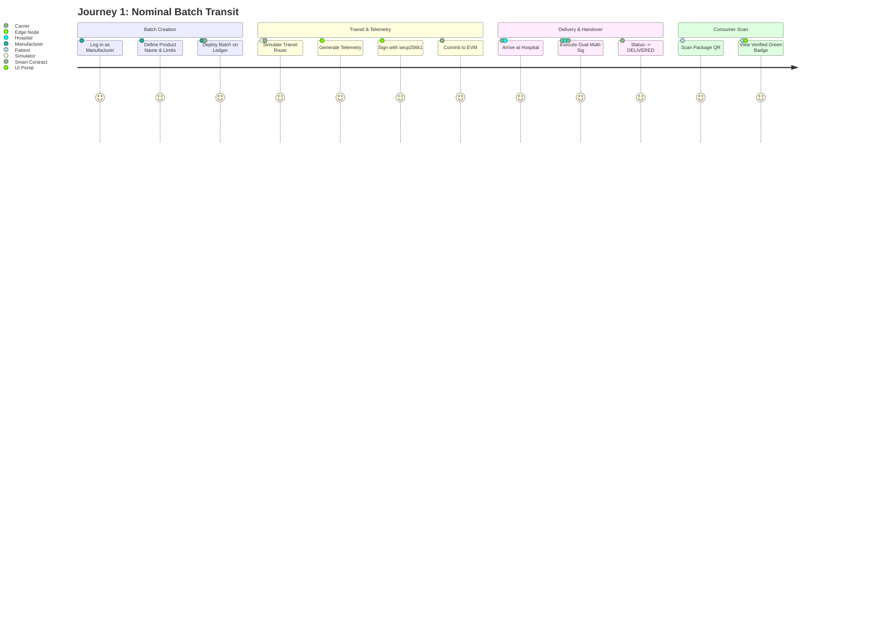
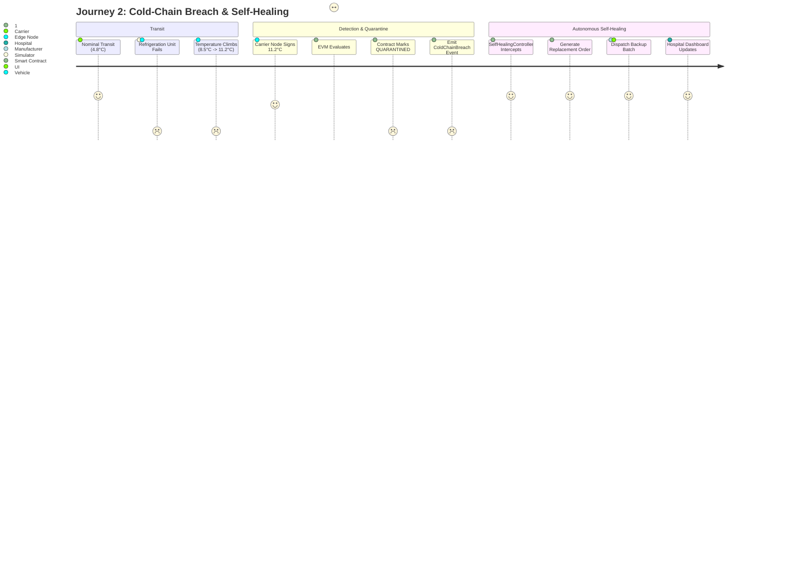
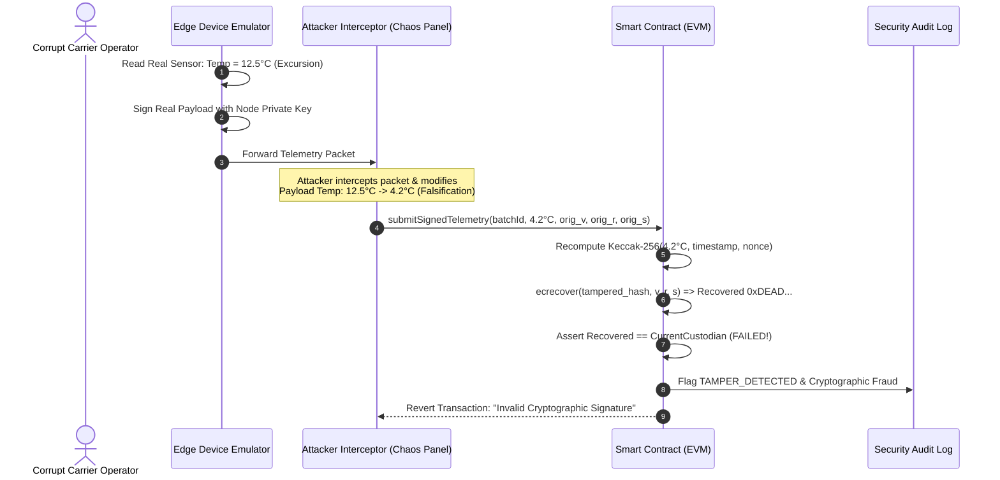

# End-to-End User Journeys & Workflow Specifications

---

## 1. WORKFLOW 1: NOMINAL BATCH GENESIS & TRANSIT

### Detailed Steps:
1. **Manufacturer Release**:
   - Manufacturer generates lot metadata: `COVID-VAX-BATCH-104`, Min Temp: `2.0°C`, Max Temp: `8.0°C`.
   - Calls `BatchManager.sol -> createBatch()`.
   - Transaction is mined into Block #102; emits `BatchCreated`.
2. **Custody Transfer to Carrier**:
   - Manufacturer signs `initiateHandover(batchId, CarrierAddress)`.
   - Carrier inspects physical cold container and signs `confirmHandover(batchId, ManufacturerAddress)`.
   - On-chain status becomes `IN_TRANSIT` with Carrier as registered custodian.
3. **Telemetry Streaming**:
   - Python simulation engine moves vehicle along GPS waypoints.
   - Temperature stays within nominal band ($4.5^\circ\text{C} \pm 0.4^\circ\text{C}$).
   - Every 5 seconds, an edge-signed telemetry checkpoint is submitted to the EVM.
   - Smart contract executes `ecrecover`, confirms Carrier's signature, validates $2.0 \le T \le 8.0$, and commits the checkpoint.
4. **Final Delivery & Acceptance**:
   - Vehicle arrives at Hospital dock.
   - Carrier and Hospital Pharmacist execute mutual handover.
   - Status updates to `DELIVERED`.

---

## 2. WORKFLOW 2: REFRIGERATION BREACH & AUTONOMOUS SELF-HEALING

### Detailed Steps:
1. **Incident Occurrence**:
   - At transit hour 3, the vehicle's refrigeration unit malfunctions (triggered via Chaos Studio or simulated stochastic failure).
   - Temperature climbs past the $8.0^\circ\text{C}$ critical ceiling to $11.2^\circ\text{C}$.
2. **Algorithmic Enforcement**:
   - The carrier node truthfully signs the $11.2^\circ\text{C}$ payload with its private key.
   - Smart contract validates signature authenticity via `ecrecover`.
   - Smart contract checks: $11.2 > 8.0 \rightarrow$ Threshold breached!
   - State instantly changes to `QUARANTINED`.
   - Contract emits event: `ColdChainBreach(batchId, 11.2C, timestamp)`.
3. **Automated Self-Healing Execution**:
   - `SelfHealingController.sol` automatically catches the breach event.
   - Triggers automated reorder: `mintReplacementBatch(originalBatchId, "COVID-VAX-BATCH-104-REP")`.
   - Dispatches emergency replacement from the nearest regional logistics depot.
   - Hospital dashboard reflects replacement ETA; damaged batch is permanently locked from being administered.

---

## 3. WORKFLOW 3: ADVERSARIAL ATTACK & TAMPER ATTEMPT

