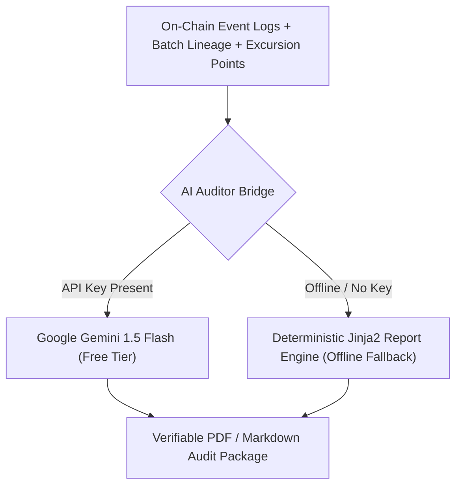

# AI Architecture & Anomaly Detection
**Zero-Cost Machine Learning & Predictive Thermal Degradation**

---

## 1. STRATEGIC PURPOSE OF AI
In cold-chain logistics, waiting until a batch reaches $8.1^\circ\text{C}$ to declare a breach results in total economic loss and clinical delays.

We implement AI where it genuinely solves a physical engineering problem:
1. **Predictive Thermal Breach Engine**: Analyzes rate of change ($dT/dt$) and container thermal momentum to forecast when a breach will occur *before* it happens, allowing drivers to fix refrigeration or reroute to a backup cold store.
2. **Cryptographic & Route Anomaly Detection**: Flags impossible velocity vectors (e.g. GPS jumping 200km in 2 minutes) or abnormal clock drift.
3. **Auditor Regulatory Assistant**: Generates human-readable compliance summaries for regulatory inspectors.

---

## 2. PREDICTIVE THERMAL MODEL (SCIKIT-LEARN)
- **Algorithm**: Polynomial Ridge Regression on sliding temporal windows ($W = 10\text{ readings}$).
- **Input Features**:
  - Rolling mean of temperature ($\bar{T}_{10}$)
  - First derivative $\frac{dT}{dt}$ (rate of heating/cooling)
  - Second derivative $\frac{d^2T}{dt^2}$ (acceleration of thermal decay)
  - Ambient external temperature ($T_{\text{ambient}}$)
- **Prediction Target**: Estimated minutes until $T(t) \ge 8.0^\circ\text{C}$ ($t_{\text{breach}}$).
- **Proactive Early Warning**: If $t_{\text{breach}} < 15\text{ minutes}$, the backend emits an `EARLY_WARNING` event to the frontend, displaying an animated amber alert.
- **Resource Footprint**: Runs in-process in Python via Scikit-learn ($<2\text{MB}$ memory, sub-millisecond inference, 100% offline, ₹0 cost).

---

## 3. AUDITOR REGULATORY ASSISTANT (GOOGLE GEMINI FLASH / DETERMINISTIC FALLBACK)
The framework includes an AI compliance reporting agent:



### Prompt Architecture:
```text
You are an FDA / CDSCO Pharmaceutical Compliance Auditor.
Analyze the following cryptographic on-chain audit trail:
- Batch ID: {batch_id}
- Manufacturer: {manufacturer_address}
- Excursion Event: Detected at timestamp {breach_time} with Temp {breach_temp}°C
- Smart Contract Action: Status moved to QUARANTINED in Block #{block_num}
- Self-Healing Event: Replenishment Lot #{replenishment_id} dispatched at {replenishment_time}

Generate a formal 21 CFR Part 11 Electronic Records Compliance Report summarizing:
1. Mathematical chain-of-custody verification.
2. Excursion incident chronology.
3. Autonomous quarantine and patient risk mitigation proof.
```
- **Cost**: ₹0 (Google Gemini Flash offers free tier of 15 RPM / 1M TPM).
- **Fallback**: If offline or no API key, standard template engine renders the exact same mathematical audit data deterministically.
