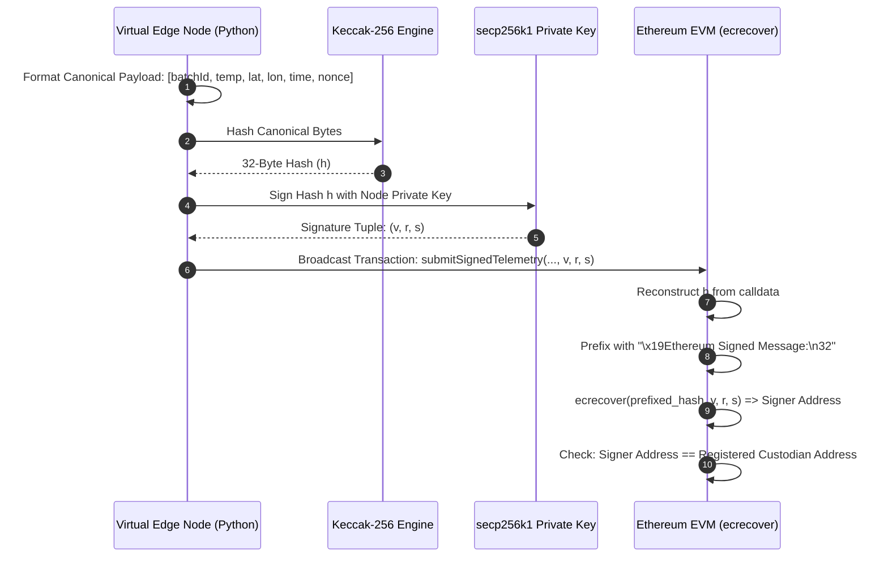

# Cryptographic Specification & Key Management
**ECDSA secp256k1, Keccak-256 & Replay Protection Architecture**

---

## 1. CRYPTOGRAPHIC FOUNDATION

The framework enforces zero-trust data provenance using Ethereum's native cryptographic primitives:

| Component | Standard / Primitive | Role in Architecture |
| :--- | :--- | :--- |
| **Elliptic Curve** | `secp256k1` | Asymmetric keypair generation for virtualized edge nodes. |
| **Digital Signature** | ECDSA ($v, r, s$) | Non-repudiation and cryptographic proof of origin. |
| **Cryptographic Hash** | `Keccak-256` | Payload fingerprinting and Ethereum prefix hashing. |
| **On-Chain Verification**| EVM opcode `0x01` (`ecrecover`) | Deterministic signature recovery on the decentralized ledger. |

---

## 2. SIGNATURE LIFECYCLE & PACKET FORMAT



---

## 3. CANONICAL ENCODING & PACKING
To prevent hash divergence between Python (off-chain) and Solidity (on-chain), data must be encoded in tight binary representation:

### Off-Chain (Python / `eth-account`):
```python
from eth_account.messages import encode_defunct
from eth_utils import keccak

# Scale float numbers to fixed-point integers
temp_scaled = int(round(temperature * 100))      # e.g., 4.25°C -> 425
lat_scaled = int(round(latitude * 1000000))      # e.g., 12.9716 -> 12971600
lon_scaled = int(round(longitude * 1000000))     # e.g., 77.5946 -> 77594600

# Canonical abi.encodePacked equivalent:
encoded_bytes = (
    bytes.fromhex(batch_id.replace("0x", "")) +
    temp_scaled.to_bytes(2, byteorder="big", signed=True) +
    lat_scaled.to_bytes(4, byteorder="big", signed=True) +
    lon_scaled.to_bytes(4, byteorder="big", signed=True) +
    int(timestamp).to_bytes(4, byteorder="big", signed=False) +
    int(nonce).to_bytes(4, byteorder="big", signed=False)
)

message_hash = keccak(encoded_bytes)
signable_message = encode_defunct(message_hash)
signed_tx = account.sign_message(signable_message)

v = signed_tx.v
r = signed_tx.r.to_bytes(32, byteorder="big")
s = signed_tx.s.to_bytes(32, byteorder="big")
```

---

## 4. REPLAY ATTACK MITIGATION
Replay attacks occur when an adversary intercepts a previously valid telemetry reading (e.g., $4^\circ\text{C}$ recorded yesterday) and re-broadcasts it during a live temperature excursion to deceive the system.

### Concrete Defenses:
1. **Monotonic Nonce**: Each node tracks an incrementing integer nonce per batch. The smart contract maintains `mapping(bytes32 => mapping(address => uint256)) public lastNonce`. If `incomingNonce <= lastNonce`, the transaction reverts with `"Replay attack detected"`.
2. **Timestamp Window Verification**: The incoming timestamp must be within an acceptable clock drift window ($\pm 60\text{ seconds}$) of the current block timestamp:
   `require(timestamp <= block.timestamp + 60 && timestamp >= block.timestamp - 300, "Timestamp out of bounds");`
