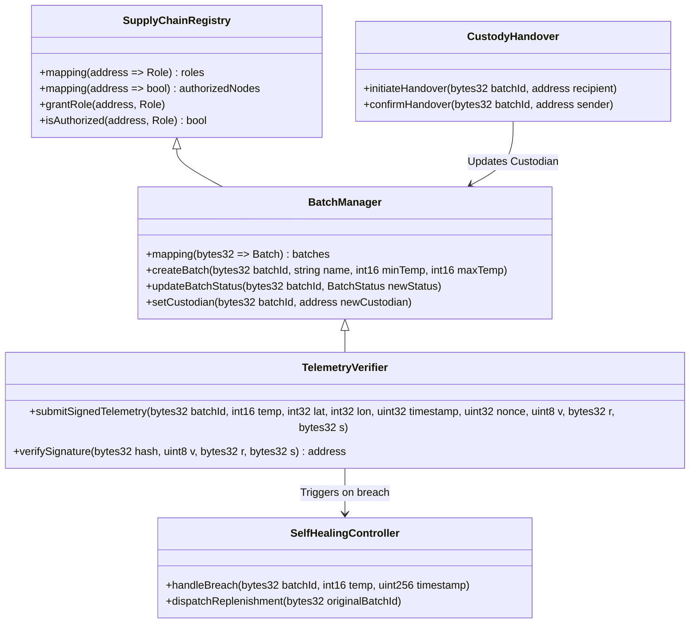

# Smart Contracts Specification & State Machines

---

## 1. CONTRACT SUITE OVERVIEW

The smart contract suite is written in Solidity `^0.8.28` and deployed to the EVM ledger. It consists of five interacting contracts:



---

## 2. DETAILED CONTRACT SPECIFICATIONS

### 2.1 `SupplyChainRegistry.sol`
- **Role Definition**:
  - `MANUFACTURER_ROLE (1)`
  - `DISTRIBUTOR_ROLE (2)`
  - `CARRIER_ROLE (3)`
  - `HOSPITAL_ROLE (4)`
  - `AUDITOR_ROLE (5)`
- **Access Control**: Uses OpenZeppelin `AccessControl` patterns to restrict critical state changes.

### 2.2 `BatchManager.sol`
- **Batch State Machine**:
  ```text
  [CREATED] ──(Handover to Carrier)──> [IN_TRANSIT] ──(Delivery at Hospital)──> [DELIVERED]
                                            │
                                    (Threshold Breach)
                                            ▼
                                      [QUARANTINED]
                                            │
                                   (Self-Healing Trigger)
                                            ▼
                                      [REPLENISHED]
  ```
- **Data Structure**:
  ```solidity
  enum BatchStatus { CREATED, IN_TRANSIT, DELIVERED, QUARANTINED, REPLENISHED }

  struct Batch {
      bytes32 batchId;
      string productName;
      address manufacturer;
      address currentCustodian;
      int16 minTempCelsiusScaled; // scaled by 100, e.g. 200 = 2.00°C
      int16 maxTempCelsiusScaled; // scaled by 100, e.g. 800 = 8.00°C
      uint32 createdAt;
      BatchStatus status;
      bytes32 replacementBatchId;
  }
  ```

### 2.3 `TelemetryVerifier.sol`
- **Verification Logic**:
  ```solidity
  function submitSignedTelemetry(
      bytes32 batchId,
      int16 temperature,
      int32 latitude,
      int32 longitude,
      uint32 timestamp,
      uint32 nonce,
      uint8 v,
      bytes32 r,
      bytes32 s
  ) external returns (bool) {
      // 1. Recompute canonical Keccak-256 hash
      bytes32 messageHash = keccak256(abi.encodePacked(
          batchId, temperature, latitude, longitude, timestamp, nonce
      ));
      bytes32 ethSignedMessageHash = keccak256(abi.encodePacked(
          "\x19Ethereum Signed Message:\n32", messageHash
      ));

      // 2. Recover signer address via ecrecover
      address signer = ecrecover(ethSignedMessageHash, v, r, s);
      require(signer != address(0), "Invalid signature format");

      // 3. Assert signer is the authorized current custodian of the batch
      Batch memory b = batchManager.getBatch(batchId);
      require(signer == b.currentCustodian, "Signer is not authorized custodian");
      require(b.status == BatchStatus.IN_TRANSIT, "Batch not in transit");

      // 4. Validate nonces to prevent replay attacks
      require(nonce > lastNonce[batchId][signer], "Replay detected: Nonce must be monotonic");
      lastNonce[batchId][signer] = nonce;

      // 5. Evaluate Cold-Chain Threshold Bounds
      if (temperature < b.minTempCelsiusScaled || temperature > b.maxTempCelsiusScaled) {
          emit ColdChainBreach(batchId, temperature, timestamp, signer);
          selfHealingController.handleBreach(batchId, temperature, timestamp);
          return false;
      }

      emit TelemetryRecorded(batchId, temperature, timestamp, signer);
      return true;
  }
  ```

### 2.4 `CustodyHandover.sol`
- **Multi-Signature Handover**:
  - Requires explicit consent from both the relinquishing party and the receiving party.
  - Mitigates unauthorized drop-offs or claims of missing shipments.

### 2.5 `SelfHealingController.sol`
- **Autonomous Recovery**:
  - Automatically called by `TelemetryVerifier` when a breach is confirmed.
  - Updates status of breached batch to `QUARANTINED`.
  - Mints an expedited replacement batch linked to the original batch:
    `replacementBatchId = keccak256(abi.encodePacked(originalBatchId, block.timestamp))`.
  - Emits `ReplenishmentOrderDispatched(originalBatchId, replacementBatchId, hospitalAddress)`.
