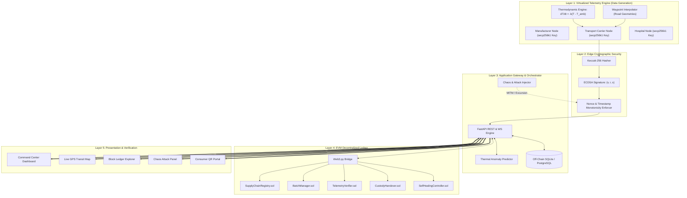

# System Architecture Specification
**Five-Layer Decentralized Traceability & Simulation Architecture**

---

## 1. HIGH-LEVEL ARCHITECTURE OVERVIEW

The framework is organized into five decoupled layers, ensuring modularity, security, and zero-cost local execution:

---

## 2. LAYER SPECIFICATIONS

### Layer 1: Virtualized Telemetry Engine
- Implemented in Python using `asyncio` and worker threads.
- Avoids physical IoT hardware costs while generating realistic data.
- Physics-based sensor model simulates ambient heat transfer, mechanical refrigeration compressor cycling, and vehicle velocity.

### Layer 2: Edge Cryptographic Security
- Every virtual node possesses an isolated private key generated using Ethereum's standard curve (`secp256k1`).
- Payloads are serialized deterministically and hashed using `Keccak-256`.
- Payloads are signed at source; signatures include $(v, r, s)$ parameters compatible with EVM `ecrecover`.

### Layer 3: Application Gateway & Orchestrator
- Python FastAPI framework running on `uvicorn`.
- Exposes RESTful endpoints for batch lifecycle operations and simulation management.
- Exposes WebSocket server for real-time telemetry fan-out to web clients.
- Manages local off-chain database (SQLite) for caching sub-second raw telemetry points.

### Layer 4: EVM Decentralized Ledger
- Runs on a local Hardhat or Anvil node (RPC at `http://127.0.0.1:8545`).
- Executes 5 Solidity smart contracts.
- Provides cryptographic consensus, immutable history, access control, and self-healing state transitions.

### Layer 5: Presentation & Verification
- React 19 + Vite web application styled with custom Obsidian Cyber-Clinical CSS tokens.
- Real-time updates delivered over WebSockets.
- Includes public mobile QR code scanner, live vehicle tracker, and on-chain block explorer.
