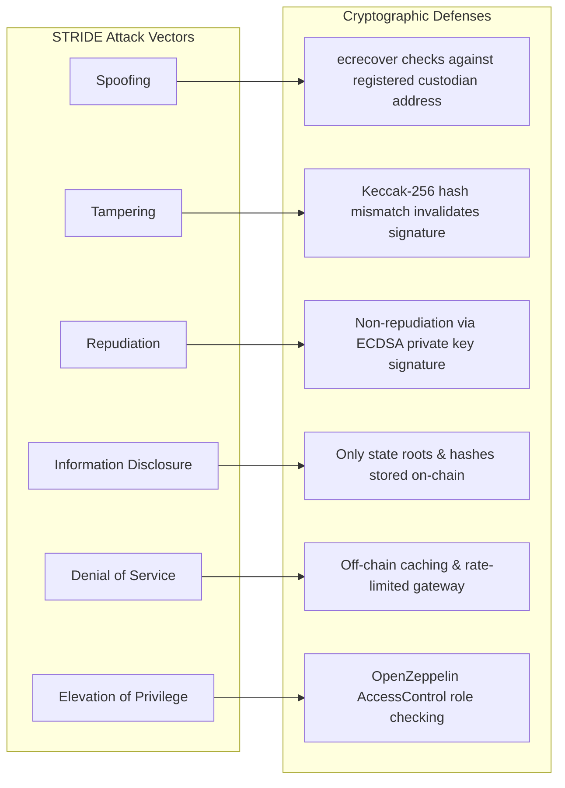

# STRIDE Threat Model & Information Security Analysis
**Grounded in the CIA Triad & Algorithmic Verification**

---

## 1. INFORMATION SECURITY: THE CIA TRIAD MAPPING

| Pillar | Centralized Vulnerability | Decentralized Algorithmic Solution | Security Mechanism |
| :--- | :--- | :--- | :--- |
| **Confidentiality** | Sensitive shipment manifests and private keys stored in centralized cloud storage with shared admin credentials. | Private keys generated and isolated in memory; route access role-gated on-chain. | ECDSA key isolation, RBAC via `SupplyChainRegistry.sol`. |
| **Integrity** | Insiders can update SQL records directly (`UPDATE telemetry SET temp = 4.0 WHERE temp > 8.0`) to conceal spoilage. | Every payload is hashed and signed at edge. Signatures verified by smart contracts. Append-only ledger blocks silent rewrites. | Keccak-256 hashing, secp256k1 digital signatures, immutable EVM blockchain. |
| **Availability** | Central server outage or ransomware crashes inventory management and blocks hospital intake. | Decentralized ledger replicates state across nodes; autonomous self-healing reorders supply without human latency. | EVM state machine, `SelfHealingController.sol` automated triggers. |

---

## 2. STRIDE THREAT MATRIX

### Detailed Threat Analysis:

### 1. Spoofing Identity (S)
- **Threat**: An unauthorized rogue vehicle broadcasts false telemetry to fake delivery progress.
- **Defense**: The smart contract verifies that the recovered signer from `ecrecover` exactly matches `BatchManager.getBatch(batchId).currentCustodian`. Any unauthorized address transaction reverts immediately.

### 2. Tampering with Data (T)
- **Threat**: A driver experiences a cooling failure ($12^\circ\text{C}$) and uses a proxy or debugging tool to edit the packet to $4^\circ\text{C}$ before it reaches the backend.
- **Defense**: Since the payload hash is computed over all fields:
  $$\text{hash} = \text{keccak256}(\text{batchId}, 4^\circ\text{C}, \text{lat}, \text{lon}, \text{timestamp}, \text{nonce})$$
  Recovering the address using the original signature $(v, r, s)$ produces an unrelated public key (`0x18aF... != custodianAddress`). The smart contract detects the fraud and flags the transaction.

### 3. Repudiation (R)
- **Threat**: A carrier damages a batch through neglect and later claims: *"We never received this shipment"* or *"The hospital broke it"*.
- **Defense**: Custody handovers require counter-signatures recorded on-chain in `CustodyHandover.sol`. The carrier's signed acceptance is permanently inscribed in block history.

### 4. Information Disclosure (I)
- **Threat**: Competitors spy on the public ledger to steal proprietary delivery routes or drug pricing.
- **Defense**: Commercial invoice terms, customer names, and pricing are kept off-chain. Only batch identifiers, cryptographic hashes, and threshold flags exist on-chain.

### 5. Denial of Service (D)
- **Threat**: An attacker floods the telemetry endpoint with millions of bogus telemetry packets.
- **Defense**: Off-chain FastAPI gateway applies IP-based rate limiting (100 req/min). On-chain updates are batched, restricting block gas consumption.

### 6. Elevation of Privilege (E)
- **Threat**: A carrier attempts to grant itself `MANUFACTURER_ROLE` to mint new batches.
- **Defense**: `SupplyChainRegistry.sol` restricts administrative functions using OpenZeppelin `AccessControl` and `DEFAULT_ADMIN_ROLE`.
