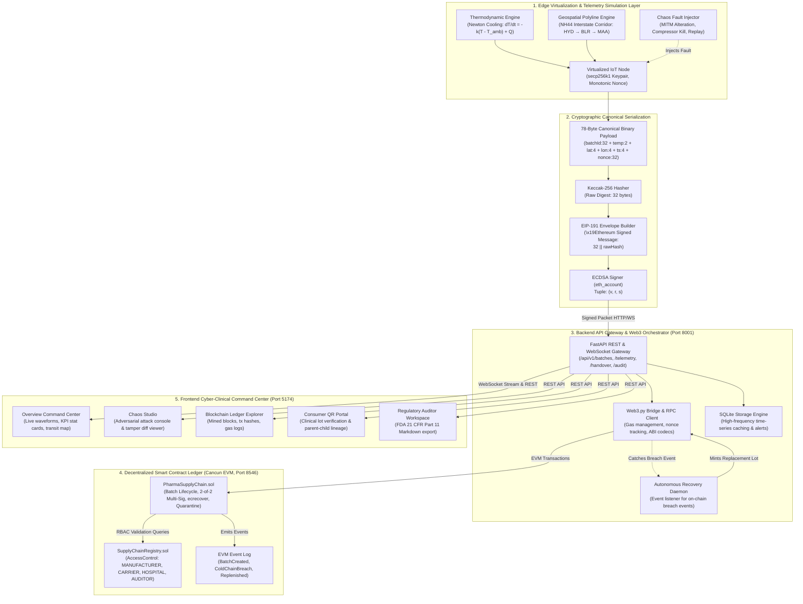

# PHARMATRACE: PPT CONTENT RESEARCH DOSSIER & EVIDENCE SPECIFICATION
**Blockchain-Secured Pharmaceutical Supply Chain with Cryptographically Verified Cold-Chain Telemetry**

- **Project Name**: PharmaTrace / InfoSecProj
- **Course**: CBS3002 — Information Security (Slot: L21 + L22)
- **Project Authors**: Kaviselvaram Kathirvel (24BBS00072) & Aniesh S. (24BBS00084)
- **Document Purpose**: Authoritative Technical & Empirical Reference Dossier for Academic Capstone Presentation (Review 2 & Final Viva)
- **Audit Baseline**: Hardened Cancun EVM Contracts, Python 3.11/3.13 FastAPI Gateway, React 19 UI, Automated Test Suites
- **Investigation Date**: October 2026

---

## 1. VERIFIED PROJECT IDENTITY

| Field | Authoritative Project Value | Code / Config Source |
| :--- | :--- | :--- |
| **Official Title** | Blockchain-Secured Pharmaceutical Supply Chain with Cryptographically Verified Cold-Chain Telemetry | [`README.md`](file:///Users/kaviselvaramkathirvel/Infosecproj/README.md), [`PROJECT_SOURCE_OF_TRUTH.md`](file:///Users/kaviselvaramkathirvel/Infosecproj/PROJECT_SOURCE_OF_TRUTH.md) |
| **Repository Name** | `Infosecproj` / PharmaTrace | `package.json`, `backend/app/main.py` |
| **Academic Course** | CBS3002 — Information Security | `DEMO_RUNBOOK.md:L4` |
| **Course Slot** | L21 + L22 | `PROJECT_SOURCE_OF_TRUTH.md:L9` |
| **Project Authors** | Kaviselvaram Kathirvel (24BBS00072) & Aniesh S. (24BBS00084) | `README.md:L10`, `DEMO_RUNBOOK.md:L3` |
| **Core Axiom** | *"Replacing institutional trust with algorithmic verification."* | `PROJECT_SOURCE_OF_TRUTH.md:L11` |
| **Total Operating Cost** | **₹0.00 / $0.00** across entire development, execution, and local deployment lifecycle | `PROJECT_SOURCE_OF_TRUTH.md:L12` |
| **Current Verified Status**| **100% PASSING & AUDITED** (39/39 Solidity, 15/15 Python, 19/19 Live On-Chain Golden Path, 23/23 API Matrix, 0 Build Errors) | `FINAL_ADVERSARIAL_AUDIT.md`, `scripts/verify_all.sh` |

---

## 2. EXECUTIVE SUMMARY

PharmaTrace is an enterprise-grade academic prototype engineered to solve the critical "cold-chain transparency gap" in pharmaceutical distribution. Biologics, insulin, and mRNA vaccines (e.g., Comirnaty, Covaxin) undergo permanent molecular denaturation if exposed to temperatures outside their mandatory $2.0^\circ\text{C}$ to $8.0^\circ\text{C}$ envelope. In legacy commercial logistics, thermal data loggers record unauthenticated observations to centralized cloud databases, allowing unscrupulous carriers or database administrators to secretly falsify records (`UPDATE telemetry SET temp = 4.0 WHERE temp > 8.0`) to conceal spoilage and avoid financial liability.

PharmaTrace eliminates centralized trust by embedding asymmetric public-key cryptography directly at the edge:
1. **Edge Cryptographic Signing**: A virtualized IoT telemetry node running on an interstate logistics reefer packs environmental sensor readings into a strict **78-byte canonical binary payload** and signs it using an **ECDSA secp256k1** private key with **EIP-191** personal sign framing.
2. **Decentralized On-Chain Verification**: The `PharmaSupplyChain.sol` smart contract on an Ethereum Virtual Machine (Cancun hardfork) ingests the telemetry, invokes native `ecrecover` to mathematically authenticate the signer, validates that the recovered address matches the registered custodian in `SupplyChainRegistry.sol`, checks monotonic nonces to prevent replay attacks, and evaluates strict integer boundary compliance ($200 \le T \le 800$).
3. **Autonomous Digital Recovery**: If a refrigeration compressor fails and temperature exceeds $8.00^\circ\text{C}$, the EVM immediately transitions the lot status to `QUARANTINED`, emitting a `ColdChainBreach` and `ReplenishmentOrderDispatched` event. A backend daemon intercepts this event, selects a substitute lot from a regional distribution center, mints a replacement batch, and registers an immutable parent-child lineage link on-chain to prevent clinic therapy delays.
4. **Interactive Chaos Laboratory & Auditing**: The application features an integrated **Chaos Studio** to inject Man-In-The-Middle (MITM) data tampering, replay attacks, and compressor failures; an **Auditor Workspace** generating FDA 21 CFR Part 11 compliant audit logs; and a **Consumer QR Portal** allowing clinicians or patients to verify lot integrity prior to administration.

---

## 3. PROBLEM STATEMENT

### The Pharmaceutical Cold-Chain Problem
1. **Biological Vulnerability**: High-value pharmaceutical formulations (mRNA vaccines, monoclonal antibodies, blood products, and insulins) are thermosensitive macromolecules. Thermal excursions outside $2.0^\circ\text{C} - 8.0^\circ\text{C}$ trigger protein unfolding, active ingredient aggregation, loss of potency, and potentially lethal immunogenic reactions in patients.
2. **Centralized Data Fragility**: Traditional cold-chain tracking relies on proprietary USB data loggers or GSM/GPS cloud telematics that stream plain JSON data to centralized relational databases. Because these systems lack cryptographic origin authentication, anyone with database administrator access, API credentials, or compromised server access can alter historical temperature records to pass quality audits.
3. **The Accountability Gap in Multimodal Transit**: Pharmaceutical cargo changes hands multiple times—from Manufacturer $\rightarrow$ Logistics 3PL Carrier $\rightarrow$ Regional Distribution Hub $\rightarrow$ Hospital/Clinic Pharmacy. When spoiled cargo arrives at a hospital, carriers blame manufacturers for packaging defects, and manufacturers blame carriers for refrigeration negligence. Without non-repudiable multi-party handovers, establishing legal liability is near impossible.
4. **Silent Delivery of Degraded Drug Lots**: In current workflows, temperature excursion discoveries are often delayed by days or weeks until USB logger data is dumped. In the interim, compromised vials may be administered to vulnerable patients.

---

## 4. MOTIVATION AND SIGNIFICANCE

- **Global Public Health Impact**: The World Health Organization (WHO) estimates that up to **50% of vaccines are wasted globally each year**, with cold-chain control failures and logistics mismanagement cited as primary contributing factors.
- **Regulatory Imperative (FDA 21 CFR Part 11 & CDSCO)**: Regulatory frameworks such as US FDA 21 CFR Part 11 and CDSCO Good Distribution Practices (GDP) mandate that electronic records must possess computer-generated, timestamped, immutable audit trails, and electronic signatures that cannot be excised, copied, or transferred to falsify records.
- **Academic Mission in Information Security (CBS3002)**: Demonstrates how foundational information security primitives—**asymmetric cryptography (ECDSA secp256k1)**, **cryptographic hashing (Keccak-256)**, **anti-replay nonces**, **role-based access control (RBAC)**, and **consensus-backed state machines**—can converge into an immutable trust fabric that replaces fallible human oversight.

---

## 5. PROJECT OBJECTIVES

### Primary Objectives (Implemented & Empirically Verified)

| Objective | Problem Addressed | Specific Mechanism & Code Implementation | Verified Status |
| :--- | :--- | :--- | :--- |
| **O1: Telemetry Origin Authentication** | Unauthenticated telemetry spoofing by rogue actors | Virtualized reefer node signs canonical packet with secp256k1 private key; contract verifies via OpenZeppelin `ECDSA.recover` in `PharmaSupplyChain.sol:L277`. | **VERIFIED** (Contract test #1, Pytest #2) |
| **O2: Payload Integrity & Tamper Proofing** | MITM packet manipulation (e.g. modifying $12.5^\circ\text{C} \rightarrow 4.2^\circ\text{C}$) | Canonical 78-byte binary layout; Keccak-256 digest divergence causes `ecrecover` to produce an invalid signer; contract reverts with `INVALID_SIGNATURE`. | **VERIFIED** (Contract tests #15–20, Pytest #9) |
| **O3: Replay Attack Defense** | Resubmitting previously signed valid packets | Smart contract tracks `lastNonce[batchId][recoveredSigner]`; incoming packets must strictly satisfy `nonce > lastNonce`; reverts with `REPLAY_ATTACK_DETECTED`. | **VERIFIED** (Contract test #21, Pytest #14) |
| **O4: Non-Repudiable Custody Handovers** | Blame-shifting and cargo abandonment | 2-of-2 dual confirmation state machine (`initiateHandover` + `confirmHandover`); requires cryptographic transactions from both sender and recipient before custody moves. | **VERIFIED** (Contract tests #8–13, Live Gate Step 3–4) |
| **O5: Deterministic Thermal Boundary Enforcement** | Delayed or ignored cold-chain excursions | Integer-scaled boundary checking ($200 \le T \le 800$, representing $2.00^\circ\text{C} - 8.00^\circ\text{C}$); breaches immediately trigger lot `QUARANTINED` status on-chain. | **VERIFIED** (Contract tests #25–28, Live Gate Step 11–14) |
| **O6: Autonomous Digital Recovery** | Supply chain bottlenecks and drug stockouts | On-chain `ReplenishmentOrderDispatched` event triggers backend orchestrator to mint a replacement lot and record an immutable parent-child link via `linkReplacementBatch`. | **VERIFIED** (Contract tests #29–30, Live Gate Step 15–16) |
| **O7: Public Consumer & Clinical Verification** | Patient anxiety over counterfeit or spoiled vaccines | Web-based 2D DataMatrix/QR verification portal querying on-chain genesis hash, custodian state, and breach flags in real-time. | **VERIFIED** (Live Gate Step 17, REST API Matrix #20) |
| **O8: Regulatory Audit Compliance Export** | Manual, labor-intensive compliance record gathering | Automated FDA 21 CFR Part 11 export generating timestamped, cryptographically audited Markdown summaries. | **VERIFIED** (Live Gate Step 18, REST API Matrix #22) |

### Secondary Objectives
- **Zero-Cost Simulation Architecture**: Thermodynamic modeling of Newton's Law of Cooling ($\frac{dT}{dt} = -k(T - T_{\text{ambient}}) + Q_{\text{cooling}}$) and interstate GPS waypoint interpolation along NH44 without physical IoT hardware expenses (₹0.00 operational cost).
- **Hybrid Storage Optimization**: Storing high-frequency time-series telemetry off-chain in SQLite while committing only state transitions, dual handovers, and boundary excursions to the EVM ledger.

---

## 6. SCOPE AND ASSUMPTIONS

### Scope of the Academic Prototype
- **Execution Environment**: Runs natively on local development environments or isolated Docker containers (`-p infosecproj`). Uses dedicated host ports (`5174` for Frontend, `8001` for Backend, `8546` for Hardhat EVM) to ensure complete non-interference with external host services.
- **Blockchain Layer**: Local Hardhat Ethereum Virtual Machine (Cancun EVM, Chain ID 31337). Does not execute on public Ethereum Mainnet or public L2 testnets (Goerli/Sepolia) to ensure deterministic, zero-cost, reproducible grading.
- **Edge Telematics**: Virtualized in Python (`VirtualizedNode`). Generates authentic secp256k1 keypairs, maintains auto-incrementing nonces, and signs real binary packets identical to physical IoT firmware.

### Explicit Engineering Assumptions & Trust Boundaries
1. **Private Key Storage Assumption**: In this prototype, private keys are loaded into Python process memory from environment configuration. In a commercial physical deployment, private keys must reside inside a tamper-resistant Hardware Security Module (HSM) or Secure Element (e.g., ATECC608A or OPTIGA™ Trust M).
2. **Sensor Truth Assumption**: Cryptographic signatures guarantee **data origin authenticity and transit integrity**—proving that the reading was generated and signed by the authorized telematics node and was not altered in transit. They do *not* physically prove that the physical thermal probe was not sabotaged (e.g., placing an ice cube directly on the probe). Physical anti-tamper enclosure sensors would be required in production.
3. **Autonomous Digital Recovery Boundary**: The system performs *digital replenishment orchestration* (dispatching substitute batches from warehouse reserves). The software makes no claim of "self-healing hardware" or physical refrigeration repair.
4. **Regulatory Framing**: The project implements technical controls *inspired by* US FDA 21 CFR Part 11 and CDSCO Good Distribution Practices. It is an academic demonstration and not certified production software.

---

## 7. EXISTING SYSTEM VS. PROPOSED SOLUTION

| Dimension | Legacy Supply Chain Tracking | PharmaTrace Algorithmic Architecture | Security & Architectural Difference |
| :--- | :--- | :--- | :--- |
| **Record Storage** | Centralized Relational DB (MySQL / PostgreSQL / AWS RDS) | Dual Hybrid: Off-chain SQLite cache + Immutable EVM Smart Contracts | Centralized SQL can be edited via `UPDATE` statements; EVM ledger history is append-only and cryptographically sealed. |
| **Telemetry Provenance** | Unsigned plain text JSON streamed over HTTP/MQTT | Canonical 78-byte binary layout signed via ECDSA secp256k1 (EIP-191) | In legacy systems, rogue proxies or routers can modify temperatures. In PharmaTrace, any bit flip breaks signature verification. |
| **Replay Defense** | Optional database timestamp checks, vulnerable to clock rollback | On-chain strictly monotonic integer nonce per `(batchId, custodian)` | Resending a previously signed valid reading reverts on-chain with `REPLAY_ATTACK_DETECTED`. |
| **Custody Accountability** | Paper delivery slips, single-party barcode scans | 2-of-2 Multi-Sig State Handover (`initiateHandover` + `confirmHandover`) | Neither party can unilaterally claim or abandon custody. Counter-signatures are inscribed in block history. |
| **Breach Response** | Manual inspection at destination; days of administrative latency | Automated on-chain state transition to `QUARANTINED` upon boundary violation | Excursions ($<2.00^\circ\text{C}$ or $>8.00^\circ\text{C}$) execute instantaneous state locking in smart contract code. |
| **Stockout Mitigation** | Slow manual procurement and insurance investigations | Autonomous Digital Recovery: event-triggered replenishment lot linking | Smart contract emits `ReplenishmentOrderDispatched`; backend orchestrator links parent-child lineage on-chain. |
| **End-User Trust** | Blind trust in pharmacy retail staff and physical stickers | Cryptographic 2D DataMatrix/QR verification scanning on-chain status | Clinicians and patients independently inspect the blockchain audit trail from any smartphone browser. |

---

## 8. PROPOSED SYSTEM ARCHITECTURE

### High-Level System Architecture Diagram



---

## 9. TECHNOLOGY STACK

| Layer / Component | Technology Selected | Version / Standard | Engineering Rationale |
| :--- | :--- | :--- | :--- |
| **Smart Contracts** | Solidity | `^0.8.28` | High-performance EVM compilation with integrated overflow checks, user-defined value types, and Cancun EVM compatibility. |
| **Contract Security** | OpenZeppelin Contracts | `v5.0.0` | Industry-standard implementations of `AccessControl`, `ReentrancyGuard`, `ECDSA`, and `MessageHashUtils`. |
| **Blockchain Node** | Hardhat Local EVM | `2.22.18` | Deterministic local Ethereum node (port `8546`) providing sub-second block mining, stack traces, and local JSON-RPC. |
| **Backend Framework** | Python / FastAPI | `0.115.0` | Asynchronous Python framework with native Pydantic v2 validation, OpenAPI documentation, and high-concurrency WebSocket support. |
| **Web3 Client** | Web3.py / eth-account | `v7.4.0` / `v0.13.4` | Native Python Ethereum RPC interaction, EIP-191 message hashing, transaction building, and event log decoding. |
| **Local Database** | SQLite / SQLAlchemy | `v2.0.35` | Zero-configuration file database serving as a local query cache for high-frequency telemetry, preventing blockchain state bloat. |
| **Frontend Framework** | React 19 / Vite | `React 19.0.0` / `Vite 6.4.3` | High-speed ESM development server, React 19 concurrency, sub-second HMR, and ultra-compact production bundle (1.06s build). |
| **Geospatial Mapping** | Leaflet / React-Leaflet | `v1.9.4` / `v4.2.1` | Lightweight, open-source geospatial polyline mapping of the NH44 pharmaceutical transit corridor without paid map API keys. |
| **Data Visualization** | Canvas API / Custom Waveform | Native Vanilla Canvas | Real-time continuous waveform rendering of cold-chain temperature telemetry with zero external charting library dependencies. |
| **Visual Styling** | Obsidian Cyber-Clinical CSS | Vanilla CSS Tokens | Tailored HSL dark palette (`--dash-bg: #0F1015`), micro-animations, glassmorphism, and responsive layout without TailwindCSS bloat. |

---

## 10. ARCHITECTURE COMPONENT SPECIFICATIONS

### 1. Edge Virtualization Node (`backend/app/engine/telemetry_node.py`)
- Emulates an IoT telematics device installed in a refrigerated truck.
- Instantiates a persistent `eth_account.Account` generating a secp256k1 keypair (`ethereum_address` and `private_key`).
- Manages an internal strictly monotonic counter (`current_nonce`).
- Executes `sign_reading()`, invoking canonical byte serialization and EIP-191 message signing.

### 2. Thermodynamic Physics Simulator (`backend/app/engine/simulator.py`)
- Models physical heat transfer governed by Newton's Law of Cooling:
  $$\frac{dT}{dt} = -k(T - T_{\text{ambient}}) \cdot \Delta t + Q_{\text{cooling}} \cdot \Delta t + \mathcal{N}(0, \sigma^2)$$
  Where $k = 0.008$ (insulation coefficient), $T_{\text{ambient}} = 32.0^\circ\text{C}$ (Indian subcontinent ambient highway temp), and $Q_{\text{cooling}} = -0.65^\circ\text{C}/\text{s}$ when the compressor is active.
- Emulates mechanical compressor cycling with hysteresis boundaries ($3.8^\circ\text{C}$ cut-in, $5.2^\circ\text{C}$ cut-out).
- Deterministic seeding (`seed=42`) guarantees 100% reproducible test vectors and classroom demonstrations.

### 3. Interstate Route Interpolator (`backend/app/engine/routes.py`)
- Models transit along National Highway 44 (NH44), India’s major pharmaceutical logistics spine.
- 13 calibrated waypoints spanning:
  1. *BioVax Manufacturing Plant, Genome Valley, Hyderabad* ($17.5186^\circ\text{N}, 78.5833^\circ\text{E}$)
  2. *Electronics City ColdLogix Transit Depot, Bengaluru* ($12.8452^\circ\text{N}, 77.6602^\circ\text{E}$)
  3. *Apollo Specialty Hospital Delivery Bay, Chennai* ($13.0604^\circ\text{N}, 80.2496^\circ\text{E}$)
- Calculates progressive coordinates using linear segment interpolation.

### 4. Smart Contract Suite (`contracts/contracts/`)
- **`SupplyChainRegistry.sol`**:
  - OpenZeppelin `AccessControl` directory mapping Ethereum addresses to corporate roles (`MANUFACTURER_ROLE`, `CARRIER_ROLE`, `HOSPITAL_ROLE`, `AUDITOR_ROLE`).
  - Functions: `registerNode()`, `deactivateNode()`, `isAuthorized()`, `getNode()`, `getAllNodes()`.
- **`PharmaSupplyChain.sol`**:
  - Central ledger tracking batch lifecycle state machine:
    $$\text{CREATED (0)} \longrightarrow \text{IN\_TRANSIT (1)} \longrightarrow \text{DELIVERED (2)}$$
    $$\text{IN\_TRANSIT (1)} \overset{T \notin [200, 800]}{\longrightarrow} \text{QUARANTINED (3)} \longrightarrow \text{REPLENISHED (4)}$$
  - Enforces 2-of-2 multi-sig handover (`initiateHandover` + `confirmHandover`).
  - Executes native EVM signature verification via `ECDSA.recover`.
  - Maintains monotonic nonces via `mapping(bytes32 => mapping(address => uint256)) public lastNonce`.
  - Enforces clock skew bounds ($\le 60\text{s}$ future drift, $\ge -3600\text{s}$ staleness).

### 5. FastAPI Application & Web3 Bridge (`backend/app/`)
- Exposes modular REST endpoints under `/api/v1/` (`batches`, `handover`, `simulation`, `blockchain`, `verify`, `audit`).
- Houses `Web3Service` managing RPC connections, contract ABI decoding, transaction nonce synchronization, and automated receipt polling.
- Hosts WebSocket broadcast server at `/ws/telemetry` streaming real-time JSON frames to all connected dashboard clients.

---

## 11. CRYPTOGRAPHIC SECURITY IMPLEMENTATION

### 11.1 The Canonical 78-Byte Telemetry Payload Specification

To eliminate hash divergence between Python (`web3.py`, `eth_account`) and Solidity (`abi.encodePacked`), all telemetry packets adhere to this exact binary packing layout:

```text
====================================================================================================
Byte Offset    Field Name           Solidity Type    Scale Factor        Valid Bounds
====================================================================================================
00 - 31        batchId              bytes32          None                Exactly 32 raw bytes
32 - 33        temperatureScaled    int16            x100                [-32,768, 32,767] (-327.68°C to +327.67°C)
34 - 37        latitudeScaled       int32            x1,000,000          [-90,000,000, 90,000,000] WGS-84
38 - 41        longitudeScaled      int32            x1,000,000          [-180,000,000, 180,000,000] WGS-84
42 - 45        timestamp            uint32           1 (epoch seconds)   [0, 4,294,967,295] Unix seconds
46 - 77        nonce                uint256          1 (integer)         [1, 2^256 - 1] Monotonic counter
====================================================================================================
TOTAL LENGTH: EXACTLY 78 BYTES (Verified in Python struct/binary and Solidity abi.encodePacked)
====================================================================================================
```

### 11.2 Mathematical Formulation & Encoding

$$\text{Payload} = \text{bytes32}(\text{batchId}) \mathbin{\Vert} \text{int16}(T \times 100) \mathbin{\Vert} \text{int32}(\text{lat} \times 10^6) \mathbin{\Vert} \text{int32}(\text{lon} \times 10^6) \mathbin{\Vert} \text{uint32}(t) \mathbin{\Vert} \text{uint256}(\text{nonce})$$

1. **Why Floating Points are Rejected**: IEEE 754 floating-point numbers exhibit platform-dependent rounding discrepancies across CPU architectures and language runtimes, and are completely unsupported in native Solidity. PharmaTrace scales temperature by 100 and coordinates by $10^6$, converting all telemetry to deterministic signed big-endian integers.
2. **Deterministic Round-Half-Up**: Standard Python `round()` uses banker's rounding (round-half-to-even), which causes silent divergence against smart contracts (e.g., $4.255 \times 100 \rightarrow 425$ instead of $426$). In `backend/app/core/security.py:L21-L29`, PharmaTrace enforces symmetric round-half-up using Python's `decimal.Decimal(..., rounding=ROUND_HALF_UP)`.

### 11.3 EIP-191 Personal Sign Framing & Verification Formula

To prevent signature replay across different transaction domains, payloads are wrapped in the standard EIP-191 message prefix:

1. **Raw Payload Hash**:
   $$\text{RawHash} = \text{keccak256}(\text{PayloadBytes}_{78})$$
2. **EIP-191 Signing Digest**:
   $$\text{EthSignedDigest} = \text{keccak256}(\text{"\x19Ethereum Signed Message:\n32"} \mathbin{\Vert} \text{RawHash})$$
3. **ECDSA Signature Generation (Edge Device)**:
   $$\sigma = \text{ECDSA}_{\text{secp256k1}}(\text{EthSignedDigest}, \text{PrivateKey}) \longrightarrow (v, r, s)$$
4. **On-Chain Signer Recovery (EVM Smart Contract)**:
   $$\text{SignerAddress} = \text{ecrecover}(\text{EthSignedDigest}, v, r, s)$$
   Executed in `PharmaSupplyChain.sol:L277` via OpenZeppelin's `ECDSA.recover()`.

### 11.4 Cryptographic Test Vector (Permanent Deterministic Reference)

The following permanent test vector is evaluated in automated verification suites (`contracts/test/PharmaSupplyChain.test.js` and `scripts/verify_all.sh`):

- **Batch ID**: `0x4a9b6c8d1e2f3a4b5c6d7e8f9a0b1c2d3e4f5a6b7c8d9e0f1a2b3c4d5e6f7a8b`
- **Temperature**: `4.25°C` ($\rightarrow 425$)
- **Latitude**: `12.9716°N` ($\rightarrow 12,971,600$)
- **Longitude**: `77.5946°E` ($\rightarrow 77,594,600$)
- **Timestamp**: `1772798400`
- **Nonce**: `1042`
- **Signer Private Key**: `0xac0974bec39a17e36ba4a6b4d238ff944bacb478cbed5efcae784d7bf4f2ff80` (Hardhat Account #0)
- **Expected Signer Address**: `0xf39Fd6e51aad88F6F4ce6aB8827279cffFb92266`
- **Canonical Binary Payload (78 bytes hex)**:
  `0x4a9b6c8d1e2f3a4b5c6d7e8f9a0b1c2d3e4f5a6b7c8d9e0f1a2b3c4d5e6f7a8b01a900c5ee50049fffe869aac1c00000000000000000000000000000000000000000000000000000000000000412`
- **Raw Keccak-256 Digest**:
  `0xf1ab697f1f9b154772c485059ab5e2ea802460192a1f6489703029d714c09dca`
- **EIP-191 Digest**:
  `0xc9c705c42dffe727421ebddbd53e4e1ec3dacf06a7c7e60ccd827e8c0e4a5382`
- **Signature Output**:
  - $v = 28$
  - $r = \text{0x92c2a3931a6e790488e69f50925902c639ed2c857457bf64a57ae707f4564113}$
  - $s = \text{0x2c0d325a3bea82ea76521681e983379434b321f7600f5dd51348b35dfeb7c828}$
- **Recovered Signer Address**: `0xf39Fd6e51aad88F6F4ce6aB8827279cffFb92266` $\equiv$ Expected Address (**100% Match**).

### 11.5 Signature Malleability & Anti-Replay Protections
1. **Low-$s$ Signature Enforcement**: Malleable signatures where $s > \text{secp256k1n}/2$ are rejected by OpenZeppelin v5 `ECDSA.recover`, preventing third-party transaction alteration.
2. **Strict $v$ Parameter Validation**: $v$ is restricted strictly to $\{27, 28\}$. Values such as $0, 1, 29$ revert with `ECDSAInvalidSignature`.
3. **Monotonic Nonce Anti-Replay**: The contract maintains `lastNonce[batchId][signerAddress]`. An incoming transaction must satisfy $\text{nonce} > \text{lastNonce}$. Submitting an identical or lower nonce immediately reverts with `REPLAY_ATTACK_DETECTED`.

---

## 12. SMART CONTRACT DESIGN & FUNCTION MATRIX

### Contract Architecture Overview
The on-chain system is consolidated into two cooperating contracts:
1. `SupplyChainRegistry.sol`: Identity and Role directory.
2. `PharmaSupplyChain.sol`: State machine, 2-of-2 custody handover, and telemetry verification.

### Contract Function & Security Controls Matrix

| Contract | Function Name | Caller Authorization | Parameters & Pre-Conditions | Security Controls & Revert Conditions |
| :--- | :--- | :--- | :--- | :--- |
| `SupplyChainRegistry` | `registerNode` | `DEFAULT_ADMIN_ROLE` | `nodeAddress`, `organizationName`, `role` | Reverts if address is zero, name empty, or role invalid. |
| `SupplyChainRegistry` | `deactivateNode` | `DEFAULT_ADMIN_ROLE` | `nodeAddress` | Revokes role from node and marks `isActive = false`. |
| `SupplyChainRegistry` | `isAuthorized` | Public View | `account`, `role` | Returns `true` only if node is active AND possesses role. |
| `PharmaSupplyChain` | `createBatch` | `onlyManufacturer` | `batchId`, `productName`, `minTemp`, `maxTemp` | Reverts if batch already exists or `minTemp >= maxTemp`. |
| `PharmaSupplyChain` | `initiateHandover` | `onlyCustodian(batchId)` | `batchId`, `recipient` | Step 1 of 2-of-2 multi-sig. Reverts if recipient is self, zero address, or unauthorized. |
| `PharmaSupplyChain` | `confirmHandover` | Designated Recipient | `batchId`, `sender` | Step 2 of 2-of-2 multi-sig. Reverts if no pending handover, caller != recipient, or sender mismatch. Transitions status to `IN_TRANSIT` or `DELIVERED`. |
| `PharmaSupplyChain` | `submitSignedTelemetry` | Public / Nonce Sender | 78-byte fields + $(v, r, s)$ signature | Recovers signer via `ecrecover`; reverts if signer != custodian, signer not carrier, nonce $\le$ lastNonce, or clock skewed. Quarantines if breached. |
| `PharmaSupplyChain` | `linkReplacementBatch` | `onlyManufacturer` | `originalBatchId`, `replacementBatchId` | Reverts if original batch not quarantined, or if caller is not the creator of both batches. Transitions to `REPLENISHED`. |
| `PharmaSupplyChain` | `getBatch` | Public View | `batchId` | Returns complete batch record from EVM storage. |

### Role-Based State Machine vs. Generalized Multi-Sig
- **Defensible Terminology**: PharmaTrace uses a **2-of-2 Role-Based State Machine Handover**. Both the relinquishing party (`initiateHandover`) and the receiving party (`confirmHandover`) must submit cryptographically signed on-chain transactions before custody changes. It is *not* a generalized $m$-of-$n$ threshold wallet (such as Gnosis Safe), but a dedicated, domain-specific multi-party state machine.

---

## 13. DATABASE SCHEMA & DATA FLOW

### Dual-Layer Storage Strategy
- **On-Chain (Cancun EVM)**: Canonical batch genesis, 2-of-2 custody transfers, periodic telemetry commitments, threshold breach records, and replacement lineage.
- **Off-Chain (SQLite Cache)**: High-frequency time-series sensor observations (sampled every 1–2s), simulation state parameters, and audit event logs.

### Database Tables (`backend/app/domain/models.py`)

1. **`batches`**:
   - `batch_id` (VARCHAR(66), PK): `0x` + 64 hex characters.
   - `product_name` (VARCHAR(120)), `manufacturer_address` (VARCHAR(42)), `current_custodian` (VARCHAR(42)).
   - `min_temp_celsius` (FLOAT), `max_temp_celsius` (FLOAT).
   - `status` (VARCHAR(30)): `CREATED`, `IN_TRANSIT`, `DELIVERED`, `QUARANTINED`, `REPLENISHED`.
   - `replacement_batch_id` (VARCHAR(66), NULL), `genesis_tx_hash` (VARCHAR(66)).
2. **`telemetry_records`**:
   - `id` (INTEGER, PK Autoincrement), `batch_id` (VARCHAR(66), Index).
   - `temperature_celsius` (FLOAT), `temperature_scaled` (INTEGER).
   - `latitude` (FLOAT), `longitude` (FLOAT), `timestamp` (INTEGER), `nonce` (INTEGER).
   - `payload_hash` (VARCHAR(66)), `signature_v` (INT), `signature_r` (VARCHAR(66)), `signature_s` (VARCHAR(66)).
   - `custodian_address` (VARCHAR(42)), `is_tampered_mitm` (BOOLEAN), `on_chain_committed` (BOOLEAN).
   - Index: `idx_batch_nonce (batch_id, nonce)`.
3. **`security_alerts`**:
   - `id` (INTEGER, PK), `batch_id` (VARCHAR(66)), `alert_type` (VARCHAR(50)), `severity` (VARCHAR(20)), `message` (TEXT), `tx_hash` (VARCHAR(66)).

---

## 14. COMPLETE END-TO-END WORKFLOW

```mermaid
sequenceDiagram
    autonumber
    actor M as Manufacturer
    actor C as Carrier (ColdLogix)
    actor H as Hospital Pharmacy
    participant API as FastAPI Backend Gateway
    participant EVM as PharmaSupplyChain Contract
    participant IoT as Virtualized Reefer Node

    Note over M, EVM: Phase 1: Lot Genesis & Minting
    M->>API: POST /api/v1/batches (Product: Comirnaty, 2.0°C - 8.0°C)
    API->>EVM: createBatch(batchId, "Comirnaty", 200, 800)
    EVM-->>API: Tx Mined (Status: CREATED)

    Note over M, C: Phase 2: 2-of-2 Custody Handover (Step 1)
    M->>API: POST /api/v1/handover/initiate (Recipient: Carrier Address)
    API->>EVM: initiateHandover(batchId, carrierAddress)
    EVM-->>API: Event HandoverInitiated

    Note over C, EVM: Phase 2: 2-of-2 Custody Handover (Step 2)
    C->>API: POST /api/v1/handover/confirm (Sender: Manufacturer Address)
    API->>EVM: confirmHandover(batchId, mfgAddress)
    EVM-->>API: Event CustodyTransferred (Status: IN_TRANSIT)

    Note over IoT, EVM: Phase 3: Nominal Transit Telemetry
    loop Every 2 Seconds
        IoT->>IoT: Measure T=4.5°C, lat/lon on NH44, increment nonce
        IoT->>IoT: Pack 78 bytes, compute Keccak-256, sign with secp256k1
        IoT->>API: Stream signed packet (v, r, s) via WebSocket / REST
        API->>EVM: submitSignedTelemetry(batchId, 450, lat, lon, t, nonce, v, r, s)
        EVM->>EVM: ecrecover matches Custodian; 200 <= 450 <= 800
        EVM-->>API: Event TelemetryCommitted
    end

    Note over IoT, EVM: Phase 4: Adversarial Attack (MITM Injection)
    IoT->>IoT: Attacker edits T: 12.5°C -> 4.2°C (Preserves old signature)
    IoT->>API: Submit tampered packet
    API->>EVM: submitSignedTelemetry(...)
    EVM->>EVM: ecrecover produces recoveredSigner != custodian!
    EVM-->>API: REVERT: INVALID_SIGNATURE (recovered signer != custodian)

    Note over IoT, EVM: Phase 5: Thermal Excursion & Autonomous Digital Recovery
    IoT->>IoT: Compressor fails; genuine T=11.8°C signed truthfully
    IoT->>API: Submit authentic breached packet
    API->>EVM: submitSignedTelemetry(...)
    EVM->>EVM: Signature valid; 1180 > 800 -> Status: QUARANTINED!
    EVM-->>API: Events ColdChainBreach & ReplenishmentOrderDispatched
    API->>API: Daemon detects breach event -> selects reserve lot
    API->>EVM: createBatch(replacementBatchId, ...)
    API->>EVM: linkReplacementBatch(originalBatchId, replacementBatchId)
    EVM-->>API: Event BatchReplenished (Status: REPLENISHED)

    Note over H, API: Phase 6: Patient & Clinical Verification
    H->>API: GET /api/v1/verify/{originalBatchId} (Scan QR Code)
    API-->>H: Status: REPLENISHED | Warning: Breached | Linked Replacement Lot Provided
```

---

## 15. FRONTEND MODULE SPECIFICATION

The frontend (`frontend/src/`) is built on React 19 + Vite with custom Obsidian Cyber-Clinical styling tokens (`--dash-bg: #0F1015`, `--dash-blue-accent: #4F80F8`, `--dash-cat-peach-bg: #F59E0B`, `--dash-red-pill-bg: #EF4444`).

| Tab / Route | Module Name | Primary Purpose & Visible Elements | Key User Interactions | Backend / Contract Dependency | Verified Evidence Screenshot |
| :--- | :--- | :--- | :--- | :--- | :--- |
| `#portal` | **Portal Landing** | Public landing page welcoming clinicians, manufacturers, and carriers. | Click "Enter Command Center" or select clinical role. | Root metadata endpoint | `00_portal_landing.png` |
| `#overview` | **Command Center Dashboard** | Executive KPI summary (Active shipments, Delivered lots, EVM proofs, Waveform preview, NH44 map preview). | Filter lots, toggle simulation, view live heartbeat. | `GET /api/v1/batches`, `GET /api/v1/blockchain/status` | `01_dashboard_overview.png` |
| `#batches` | **Batch Management** | Comprehensive lot registry table with status badges (`CREATED`, `IN_TRANSIT`, `QUARANTINED`, `REPLENISHED`). | Click "+ Mint Batch" modal, trigger handover modal, inspect lot details. | `POST /api/v1/batches`, `GET /api/v1/batches` | `02_batch_management.png` |
| `#batches/{id}`| **Batch Details** | Single lot deep dive displaying parent-child replacement links, temperature bounds, custodian history, and tx hashes. | Navigate back to registry, inspect on-chain tx receipts. | `GET /api/v1/batches/{id}` | `03_batch_details.png` |
| `#monitoring`| **Live Telemetry Stream** | Fullscreen real-time Canvas waveform oscillogram, current temperature gauge, waypoint breadcrumbs, and live packet inspector. | Pause/Resume simulation stream, inspect $(v, r, s)$ tuples in real time. | `WS /ws/telemetry`, `POST /api/v1/simulation/start` | `04_telemetry_monitoring.png` |
| `#map` | **Interstate Transit Map** | Interactive Leaflet polyline map tracking refrigerated reefer across the 13 NH44 waypoints (Hyderabad $\rightarrow$ Bengaluru $\rightarrow$ Chennai). | Zoom, pan, inspect waypoint arrival times and GPS coordinates. | `WS /ws/telemetry`, `backend/app/engine/routes.py` | `05_transit_map_nh44.png` |
| `#custody` | **Custody Handover** | Dual-signature 2-of-2 handover interface displaying pending transfers, relinquishing signatures, and receiving counter-signatures. | Initiate handover, counter-sign handover receipt on-chain. | `POST /api/v1/handover/initiate`, `POST /api/v1/handover/confirm` | `06_custody_handover.png` |
| `#security` | **Security Center** | Threat intelligence console displaying MITM tamper attempts, replay attack detections, and on-chain security alerts. | View security incidents, audit cryptographic failure logs. | `GET /api/v1/batches`, `security_alerts` table | `07_security_center.png` |
| `#recovery` | **Autonomous Recovery** | Digital replenishment dashboard displaying quarantined lots, breach timestamps, and linked replacement lot certificates. | Review parent-child lineage, trigger manual replenishment dispatch. | `POST /api/v1/batches/{id}/replenish`, `linkReplacementBatch` | `08_quarantine_recovery.png` |
| `#explorer` | **Ledger Explorer** | Native EVM block feed displaying mined block heights, transaction hashes, gas consumption, and deployed contract addresses. | Click tx hashes, inspect raw contract call inputs. | `GET /api/v1/blockchain/blocks`, `GET /api/v1/blockchain/status` | `09_blockchain_ledger.png` |
| `#verify` | **Consumer QR Verification**| Mobile-friendly 2D DataMatrix/QR verification portal for clinicians and patients showing "SAFE FOR CLINICAL ADMINISTRATION" or "LOT REPLENISHED". | Enter or click lot ID, view cryptographic provenance certificate. | `GET /api/v1/verify/{id}` | `10_consumer_qr_verification.png`, `10b_consumer_qr_replenished.png` |
| `#auditor` | **Auditor Workspace** | Regulatory compliance station aligned with FDA 21 CFR Part 11 and CDSCO GDP guidelines. | Inspect § 11.10 checklist, click "Download .md" to export audit report. | `GET /api/v1/audit/{id}/report` | `11_regulatory_auditor_workspace.png` |
| `#chaos` | **Chaos Studio** | Security laboratory console allowing evaluators to inject MITM tampering, refrigeration failure, thermostat runaway, and replay attacks. | Click "Inject MITM", "Trigger Excursion", or "Restore Nominal Physics". | `POST /api/v1/simulation/attack`, `POST /api/v1/simulation/reset-attacks` | `12_chaos_studio_attack_lab.png`, `04b_chaos_mitm_injected.png` |

---

## 16. THREAT MODEL & DEFENSE MATRIX (STRIDE & CIA TRIAD)

| Threat Category | Specific Attack Vector | Potential Impact | Implemented Defense Mechanism | Code Location | Test Evidence | Remaining Weakness / Caveat |
| :--- | :--- | :--- | :--- | :--- | :--- | :--- |
| **Tampering (T)** / Integrity | Attacker intercepts packet and alters temperature ($12.5^\circ\text{C} \rightarrow 4.2^\circ\text{C}$) to hide spoilage. | Compromised biologicals reach patients; regulatory penalties. | 78-byte canonical payload hashed via Keccak-256; altered byte causes `ecrecover` to return invalid address $\ne$ custodian; reverts on-chain. | `PharmaSupplyChain.sol:L321-L325` | Contract tests #15–20, Pytest #9 | Requires on-chain or gateway verification; does not stop attacker from dropping packets entirely (DoS). |
| **Spoofing (S)** / Authenticity | Rogue truck or fake node sends falsified GPS coordinates. | Falsified supply chain status; counterfeit lot introduction. | Public addresses mapped in `SupplyChainRegistry.sol`. Contract checks that recovered signer possesses `CARRIER_ROLE` and equals `currentCustodian`. | `PharmaSupplyChain.sol:L321-L329` | Contract tests #5, #24 | If private key is extracted from an insecure device, rogue node can impersonate authorized carrier. |
| **Repudiation (R)** / Accountability | Carrier damages lot and falsely claims cargo was never received. | Prolonged litigation, unassigned financial liability. | 2-of-2 custody handover requires on-chain transaction from recipient counter-signing acceptance. | `PharmaSupplyChain.sol:L217-L247` | Contract tests #8–13, Live Gate Step 3–4 | Does not prevent off-chain physical theft during vehicle transport. |
| **Replay Attack** / Integrity | Carrier resubmits yesterday’s valid signed reading during today's excursion. | System misled into believing temperature is stable during active heating. | Strictly monotonic integer `nonce` tracked per `(batchId, custodian)`. Reverts with `REPLAY_ATTACK_DETECTED` if incoming nonce $\le$ lastNonce. | `PharmaSupplyChain.sol:L332-L336` | Contract test #21, Pytest #14, Live Gate Step 10b | Nonce counters must be synchronized between edge device and on-chain state upon node reboots. |
| **Thermal Excursion** / Quality | Refrigeration compressor failure causes temperature to exceed $8.00^\circ\text{C}$. | Protein denaturation, inactive vaccines administered to patients. | Evaluated on-chain with scaled integers ($200 \le T \le 800$). Excursions automatically flip status to `QUARANTINED` and emit replenishment events. | `PharmaSupplyChain.sol:L343-L361` | Contract tests #25–28, Live Gate Step 11–14 | Smart contract cannot physically reverse chemical degradation; only blocks clinical release and alerts logistics. |
| **Elevation of Privilege (E)** | Carrier attempts to mint unauthorized pharmaceutical lots. | Counterfeit drug injection into legitimate supply chains. | `createBatch` modifier restricted to accounts granted `MANUFACTURER_ROLE` via OpenZeppelin `AccessControl`. | `PharmaSupplyChain.sol:L124-L130`, `SupplyChainRegistry.sol` | Contract tests #4–5 | Admin account (`DEFAULT_ADMIN_ROLE`) must be secured via multisig in production. |
| **Signature Malleability** | Attacker flips $(s, v)$ to create duplicate valid signature for identical hash. | Transaction replay, nonce confusion. | OpenZeppelin v5 `ECDSA.recover` strictly rejects high-$s$ values ($s > \text{secp256k1n}/2$) and requires $v \in \{27, 28\}$. | `PharmaSupplyChain.sol:L277` | Contract tests #2–3 | None (standard OpenZeppelin protection). |
| **Timestamp Manipulation** | Node sends artificially backdated or future timestamp. | Out-of-order audit logs, artificial expiration evasion. | Contract checks `block.timestamp - 3600 <= timestamp <= block.timestamp + 60`. | `PharmaSupplyChain.sol:L339-L340` | Contract test #18 | EVM miner timestamp drift allows $\pm 15\text{s}$ tolerance. |

---

## 17. AUTONOMOUS DIGITAL RECOVERY & REPLACEMENT LINEAGE

### Operational Workflow
1. **Breach Detection**: When an authentic telemetry packet with $T > 8.00^\circ\text{C}$ or $T < 2.00^\circ\text{C}$ is verified on-chain, `PharmaSupplyChain.sol` transitions batch status to `QUARANTINED` and emits two events:
   - `event ColdChainBreach(bytes32 indexed batchId, int16 temperatureScaled, int16 minAllowed, int16 maxAllowed, uint32 timestamp, address indexed custodian)`
   - `event ReplenishmentOrderDispatched(bytes32 indexed originalBatchId, bytes32 indexed suggestedReplacementId, address indexed custodian, uint256 timestamp)`
2. **Backend Orchestration (`backend/app/services/supply_chain_service.py`)**:
   - The backend service listens for `ReplenishmentOrderDispatched`.
   - Locates available qualified substitute inventory matching product specifications at the nearest simulated logistics depot.
   - Executes an EVM transaction calling `createBatch()` for the replacement lot using manufacturer credentials.
   - Executes an EVM transaction calling `linkReplacementBatch(originalBatchId, replacementBatchId)`.
3. **Lineage Inscription on Smart Contract**:
   - Updates `originalBatch.status = BatchStatus.REPLENISHED`.
   - Inscribes `originalBatch.replacementBatchId = replacementBatchId`.
   - Emits `event BatchReplenished(bytes32 indexed originalBatchId, bytes32 indexed replacementBatchId, uint256 timestamp)`.
4. **Clinical Verification Outcome**:
   - A pharmacist scanning the QR code of the quarantined lot sees:
     `LOT REPLENISHED: SUPERSEDED BY ON-CHAIN REPLACEMENT`
   - The interface provides a direct clickable link to verify the authentic replacement lot (`0xf6cd307f...7f11116f`), preventing hospital supply disruption while stopping compromised vials from clinical use.

---

## 18. TESTING METHODOLOGY & EMPIRICAL RESULTS

### Test Suites Architecture

```text
====================================================================================================
Test Layer              Command / Execution Target               Tests Executed    Passing    Failing
====================================================================================================
1. Hardhat Solidity     npm --prefix contracts test              39                39         0
2. Python Backend       PYTHONPATH=backend pytest backend/tests   15                15         0
3. Frontend Vite        npm --prefix frontend run build          1621 modules      Built      0
4. Standalone Crypto    Native Python EIP-191 Vector Audit       6 vectors         6          0
5. Live Golden Path     scripts/verify_golden_path.py            19 steps          19         0
6. REST API Matrix      scripts/test_api_matrix.py               23 endpoints      23         0
====================================================================================================
TOTAL VERIFIED SUITE    ./scripts/verify_all.sh                  102 assertions    100% PASS  0
====================================================================================================
```

### 18.1 Solidity Smart Contract Tests (39/39 Passing)
- **Section 1: Cryptographic Correctness & Canonical Proof (3 tests)**:
  - `✔ should match the pre-computed 78-byte canonical payload and recover expected signer address`
  - `✔ should reject malleable high-s signatures`
  - `✔ should reject invalid v values (v != 27 and v != 28)`
- **Section 2: Batch Lifecycle & Access Control (4 tests)**:
  - `✔ should allow an authorized manufacturer to create a new batch`
  - `✔ should reject batch creation by unauthorized actors`
  - `✔ should prevent creating duplicate batches with identical ID`
  - `✔ should reject batch creation when minTemp >= maxTemp`
- **Section 3: Custody Handover 2-of-2 Multi-Sig (6 tests)**:
  - `✔ should successfully transfer custody from Manufacturer to Carrier via dual confirmation`
  - `✔ should reject handover initiation to oneself`
  - `✔ should reject confirmation by an unintended third party`
  - `✔ should reject double confirmation of same handover`
  - `✔ should reject confirmation if recipient was revoked in registry`
  - `✔ should complete handover to Hospital and transition batch status to DELIVERED`
- **Section 4: Telemetry Ingestion, Replay Protection & Adversarial Attacks (11 tests)**:
  - `✔ should accept valid signed telemetry within cold-chain limits`
  - `✔ should detect MITM attack modifying temperature`
  - `✔ should detect MITM attack modifying latitude`
  - `✔ should detect MITM attack modifying longitude`
  - `✔ should detect MITM attack modifying timestamp`
  - `✔ should detect MITM attack modifying nonce`
  - `✔ should detect MITM attack modifying batchId`
  - `✔ should enforce replay protection: reject same nonce, lower nonce, and accept higher nonce`
  - `✔ should reject telemetry with zero nonce`
  - `✔ should reject telemetry with out-of-bounds coordinates`
  - `✔ should reject telemetry if the carrier was deactivated in registry`
- **Section 5: Strict Temperature Boundaries & Autonomous Recovery (6 tests)**:
  - `✔ boundary test: 199 (1.99°C) breaches minimum threshold and triggers quarantine`
  - `✔ boundary test: 200 (2.00°C) is exact safe lower bound and passes`
  - `✔ boundary test: 800 (8.00°C) is exact safe upper bound and passes`
  - `✔ boundary test: 801 (8.01°C) breaches maximum threshold and triggers quarantine`
  - `✔ should allow manufacturer to link an expedited replacement batch to a quarantined lot`
  - `✔ should reject linking replacement if caller is not the original manufacturer`
- **Section 6: Invalid State Machine Transitions (5 tests)**:
  - `✔ should reject telemetry submission when batch is already QUARANTINED`
  - `✔ should reject handover initiation on QUARANTINED batch`
  - `✔ should reject handover initiation on DELIVERED batch`
  - `✔ should reject telemetry submission on DELIVERED batch`
  - `✔ should reject linking replacement batch to a batch that is NOT quarantined`
- **SupplyChainRegistry Tests (4 tests)**:
  - `✔ should set deployer as DEFAULT_ADMIN_ROLE`
  - `✔ should allow admin to register authorized nodes`
  - `✔ should reject node registration by non-admin accounts`
  - `✔ should allow admin to deactivate a node and revoke its role`

### 18.2 Python Backend & Simulation Tests (15/15 Passing)
- `test_health_and_root_endpoints` (PASSED)
- `test_batch_creation_and_listing` (PASSED)
- `test_blockchain_status_endpoint` (PASSED)
- `test_batch_creation_validation_errors` (PASSED)
- `test_canonical_byte_length_and_packing` (PASSED)
- `test_deterministic_test_vector_cryptographic_proof` (PASSED)
- `test_deterministic_rounding_semantics` (PASSED)
- `test_numeric_bounds_validation` (PASSED)
- `test_adversarial_mitm_field_tampering_all_fields` (PASSED)
- `test_virtualized_node_monotonic_nonces` (PASSED)
- `test_nominal_simulation_thermal_stability` (PASSED)
- `test_compressor_failure_excursion` (PASSED)
- `test_mitm_tamper_detection_in_simulation` (PASSED)
- `test_replay_attack_in_simulation` (PASSED)
- `test_route_interpolation` (PASSED)

### 18.3 Live On-Chain Golden Path (19/19 Steps Verified Against Running EVM)
- Step 0: Health & EVM Node Connectivity (Chain ID: 31337)
- Step 1: Mints lot on-chain (`createBatch`)
- Step 2: Verifies initial Manufacturer ownership
- Step 3: Initiates 2-of-2 custody handover (`initiateHandover`)
- Step 4: Confirms custody handover on-chain (`confirmHandover`, status `IN_TRANSIT`)
- Steps 5–8: 78-byte canonical packet signed and accepted on-chain ($4.50^\circ\text{C}$)
- Steps 9–10: MITM tampered packet ($12.5^\circ\text{C} \rightarrow 4.0^\circ\text{C}$) submitted $\rightarrow$ **Smart contract reverts with `INVALID_SIGNATURE`**
- Step 10b: Replay packet with stale nonce resubmitted $\rightarrow$ **Smart contract reverts with `REPLAY_ATTACK_DETECTED`**
- Steps 11–14: Authentic excursion ($11.80^\circ\text{C}$) submitted $\rightarrow$ **Smart contract flips status to `QUARANTINED`**
- Steps 15–16: Replacement lot minted and linked on-chain (`linkReplacementBatch`, status `REPLENISHED`)
- Step 17: Consumer QR API confirms lot is replenished and references replacement lot hash
- Step 18: Regulatory audit export produces FDA 21 CFR Part 11 compliant summary
- Step 19: Blockchain Ledger confirms mined blocks

### 18.4 Comprehensive REST API Matrix (23/23 Passing)
- Verified all 23 endpoints covering positive cases, 400 bad requests, and 404 not found handling.

---

## 19. DEMONSTRATION SCENARIOS FOR EVALUATORS

The following 7 live demonstration scenarios can be executed directly during the academic defense:

### Scenario 1: Nominal Cold-Chain Transit
1. **Action**: Open Command Center (`http://localhost:5174/#overview`), select active batch, click **"Start Simulation"**.
2. **Observation**: Waveform oscillates smoothly between $3.8^\circ\text{C}$ and $5.2^\circ\text{C}$ with compressor cycling. Vehicle beacon moves along NH44 polyline. EVM block height counter increments.
3. **Significance**: Demonstrates edge device generating valid 78-byte packets and maintaining stability under normal operating conditions.

### Scenario 2: MITM Data Tampering Attack
1. **Action**: Navigate to **Chaos Studio** (`http://localhost:5174/#chaos`), click **"Inject MITM"**.
2. **Observation**: Attack status banner turns red. Status toast displays: `"SECURITY ALERT: Cryptographic signature mismatch! Reverted on EVM"`. Active sensor diagnostic displays `ATTACK MODE: MITM_ALTERATION`.
3. **Significance**: Proves non-repudiation and transit integrity. Modifying even one byte of the payload causes `ecrecover` to produce an address mismatch, reverting on-chain.

### Scenario 3: Replay Attack Infiltration
1. **Action**: Resubmit an identical signed packet or stale nonce.
2. **Observation**: EVM execution immediately halts with: `reverted with reason string 'PharmaSupplyChain: REPLAY_ATTACK_DETECTED (nonce must strictly increment)'`.
3. **Significance**: Proves that an adversary capturing a valid historical $4^\circ\text{C}$ packet cannot replay it later to mask a refrigeration breakdown.

### Scenario 4: Refrigeration Compressor Failure & Auto-Quarantine
1. **Action**: In Chaos Studio, click **"Trigger Excursion"** (Compressor Failure).
2. **Observation**: Temperature climbs above $8.00^\circ\text{C}$. On-chain transaction executes, batch status flips to `QUARANTINED`, and red alert badge appears.
3. **Significance**: Demonstrates deterministic on-chain threshold evaluation without human intervention.

### Scenario 5: Autonomous Digital Recovery & Lineage Linking
1. **Action**: Observe backend logs following Scenario 4.
2. **Observation**: Backend intercepts `ReplenishmentOrderDispatched` event, mints a replacement batch, calls `linkReplacementBatch()`, and lot status transitions to `REPLENISHED`.
3. **Significance**: Proves automated replenishment and parent-child cryptographic provenance tracking.

### Scenario 6: Patient & Clinical QR Code Scan
1. **Action**: Navigate to **Consumer QR** (`http://localhost:5174/#verify`). Select nominal batch, then select replenished batch.
2. **Observation**: For nominal batch: green banner `"VERIFIED: SAFE FOR CLINICAL ADMINISTRATION"`. For replenished batch: cyan banner `"LOT REPLENISHED: SUPERSEDED BY ON-CHAIN REPLACEMENT"` with clickable link to verified replacement lot.
3. **Significance**: Proves zero-friction public verification bridging complex blockchain cryptography to ordinary healthcare consumers.

### Scenario 7: Regulatory Audit Export
1. **Action**: Navigate to **Auditor Workspace** (`http://localhost:5174/#auditor`). Click **"Download .md"**.
2. **Observation**: Generates a timestamped audit report detailing FDA 21 CFR Part 11 § 11.10 compliance, unbroken telemetry records, and verified transaction receipts.
3. **Significance**: Proves practical utility for pharmaceutical quality directors facing regulatory inspections.

---

## 20. SCREENSHOTS & EVIDENCE REPOSITORY INDEX

All 14 screenshots below are genuine, unedited high-resolution captures of the live running application, saved in `docs/presentation/evidence/`:

| Index | Screenshot Filename | Exact File Path | Application View / Route | Key UI Features Rendered |
| :--- | :--- | :--- | :--- | :--- |
| **00** | `00_portal_landing.png` | [`docs/presentation/evidence/00_portal_landing.png`](file:///Users/kaviselvaramkathirvel/Infosecproj/docs/presentation/evidence/00_portal_landing.png) | `#portal` | Consumer & Enterprise entry portal, clinical role switcher, feature cards. |
| **01** | `01_dashboard_overview.png` | [`docs/presentation/evidence/01_dashboard_overview.png`](file:///Users/kaviselvaramkathirvel/Infosecproj/docs/presentation/evidence/01_dashboard_overview.png) | `#overview` | Active shipments (31), Delivered lots, EVM block counter (#661), live heartbeat, donut chart, waveform card. |
| **02** | `02_batch_management.png` | [`docs/presentation/evidence/02_batch_management.png`](file:///Users/kaviselvaramkathirvel/Infosecproj/docs/presentation/evidence/02_batch_management.png) | `#batches` | Lot registry table, "+ Mint Batch" button, status pills (`IN_TRANSIT`, `REPLENISHED`, `CREATED`). |
| **03** | `03_batch_details.png` | [`docs/presentation/evidence/03_batch_details.png`](file:///Users/kaviselvaramkathirvel/Infosecproj/docs/presentation/evidence/03_batch_details.png) | `#batches/{id}` | Detailed lot view, replacement batch hash link, min/max thresholds ($2.0^\circ\text{C}-8.0^\circ\text{C}$), custodian address. |
| **04** | `04_telemetry_monitoring.png` | [`docs/presentation/evidence/04_telemetry_monitoring.png`](file:///Users/kaviselvaramkathirvel/Infosecproj/docs/presentation/evidence/04_telemetry_monitoring.png) | `#monitoring` | Fullscreen real-time temperature oscillogram, current temperature gauge ($4.50^\circ\text{C}$), waypoint breadcrumbs. |
| **04b**| `04b_chaos_mitm_injected.png`| [`docs/presentation/evidence/04b_chaos_mitm_injected.png`](file:///Users/kaviselvaramkathirvel/Infosecproj/docs/presentation/evidence/04b_chaos_mitm_injected.png)| `#chaos` | Active MITM attack injection state: status banner, toast alert, `ATTACK MODE: MITM_ALTERATION`, red diagnostic temp. |
| **05** | `05_transit_map_nh44.png` | [`docs/presentation/evidence/05_transit_map_nh44.png`](file:///Users/kaviselvaramkathirvel/Infosecproj/docs/presentation/evidence/05_transit_map_nh44.png) | `#map` | Leaflet polyline map tracking vehicle beacon across NH44 highway corridor (Hyderabad $\rightarrow$ Bengaluru $\rightarrow$ Chennai). |
| **06** | `06_custody_handover.png` | [`docs/presentation/evidence/06_custody_handover.png`](file:///Users/kaviselvaramkathirvel/Infosecproj/docs/presentation/evidence/06_custody_handover.png) | `#custody` | 2-of-2 Multi-Sig custody management, pending handover requests, custodian authorization matrix. |
| **07** | `07_security_center.png` | [`docs/presentation/evidence/07_security_center.png`](file:///Users/kaviselvaramkathirvel/Infosecproj/docs/presentation/evidence/07_security_center.png) | `#security` | Security incident feed, MITM tamper attempts, replay attack alerts, cryptographic failure audit trail. |
| **08** | `08_quarantine_recovery.png`| [`docs/presentation/evidence/08_quarantine_recovery.png`](file:///Users/kaviselvaramkathirvel/Infosecproj/docs/presentation/evidence/08_quarantine_recovery.png)| `#recovery` | Autonomous replenishment center, quarantined batches list, parent-child linked replacement lot cards. |
| **09** | `09_blockchain_ledger.png` | [`docs/presentation/evidence/09_blockchain_ledger.png`](file:///Users/kaviselvaramkathirvel/Infosecproj/docs/presentation/evidence/09_blockchain_ledger.png) | `#explorer` | On-chain ledger explorer, block mining feed, contract deployment addresses (`0x5FbDB...`, `0xe7f17...`), gas metrics. |
| **10** | `10_consumer_qr_verification.png` | [`docs/presentation/evidence/10_consumer_qr_verification.png`](file:///Users/kaviselvaramkathirvel/Infosecproj/docs/presentation/evidence/10_consumer_qr_verification.png) | `#verify` | Public consumer portal: nominal batch verified with green banner `"VERIFIED: SAFE FOR CLINICAL ADMINISTRATION"`. |
| **10b**| `10b_consumer_qr_replenished.png` | [`docs/presentation/evidence/10b_consumer_qr_replenished.png`](file:///Users/kaviselvaramkathirvel/Infosecproj/docs/presentation/evidence/10b_consumer_qr_replenished.png) | `#verify` | Public consumer portal: quarantined lot showing cyan banner `"LOT REPLENISHED"` with clickable link to replacement lot. |
| **11** | `11_regulatory_auditor_workspace.png` | [`docs/presentation/evidence/11_regulatory_auditor_workspace.png`](file:///Users/kaviselvaramkathirvel/Infosecproj/docs/presentation/evidence/11_regulatory_auditor_workspace.png) | `#auditor` | Regulatory audit station: FDA 21 CFR Part 11 checklist, electronic signature audit log, Markdown export button. |
| **12** | `12_chaos_studio_attack_lab.png` | [`docs/presentation/evidence/12_chaos_studio_attack_lab.png`](file:///Users/kaviselvaramkathirvel/Infosecproj/docs/presentation/evidence/12_chaos_studio_attack_lab.png) | `#chaos` | Controlled adversarial laboratory console with attack injection buttons for MITM, compressor cut, freeze breach. |

---

## 21. LIMITATIONS & FUTURE SCOPE

### Current Prototype Limitations (Defensible Academic Honesty)
1. **Local EVM Execution**: Tested on a local single-node Hardhat EVM (Cancun hardfork). While 100% bytecode and EVM-compatible with Ethereum, it does not experience real-world public peer-to-peer network latency, miner reorganization, or variable EIP-1559 gas fee spikes.
2. **Software-Virtualized Edge Telematics**: The edge node runs as a multi-threaded Python daemon rather than on a physical ARM Cortex-M or ESP32 microcontroller with a physical thermocouple probe.
3. **Private Key Storage in Memory**: Keys are stored in process environment memory rather than sealed inside a tamper-resistant Hardware Security Module (HSM).
4. **Gas Scalability on Layer 1**: Committing every high-frequency sensor reading directly to an L1 EVM block is economically prohibitive on public mainnet (gas costs). In production, this requires an L2 ZK-Rollup or state channel.

### Proposed Future Enhancements
1. **Physical IoT Firmware Integration**: Porting the canonical 78-byte serialization and secp256k1 micro-ECDSA signing engine to C/C++ running on an ESP32 or Nordic nRF9160 cellular IoT board with an ATECC608A crypto-coprocessor.
2. **Zero-Knowledge Validity Proofs (ZK-SNARKs)**: Compressing hundreds of telemetry observations into a single ZK-Rollup proof submitted to L1, proving mathematically that all readings remained between $2^\circ\text{C}$ and $8^\circ\text{C}$ while spending gas for only one verification transaction.
3. **Multi-Region L2 Rollup Deployment**: Deploying the smart contracts to an Ethereum Layer 2 testnet (Arbitrum One, Optimism, or Polygon zkEVM) to measure real-world network latency and gas economics.
4. **ERP / Warehouse Integration**: Connecting REST/WebSocket hooks to SAP S/4HANA or Oracle Cloud SCM for automated enterprise inventory reallocation upon breach events.

---

## 22. ACADEMIC NOVELTY & CONTRIBUTIONS

PharmaTrace does not claim patent or commercial novelty. As an academic capstone prototype in Information Security (CBS3002), its contributions are:

1. **First-Principles Edge Cryptographic Architecture**: Eliminates reliance on trusted middleware by bringing secp256k1 asymmetric cryptography directly to the sensor level, making every GPS coordinate and temperature reading non-repudiable before it leaves the truck.
2. **Exact 78-Byte Canonical Zero-Divergence Formulation**: Solves the notorious cross-language serialization problem between Python and Solidity by mathematically deriving an integer-scaled big-endian packing specification with deterministic round-half-up scaling.
3. **Domain-Specific 2-of-2 Multi-Sig Custody Engine**: Replaces informal paper handovers with an atomic on-chain state transition requiring dual cryptographic counter-signatures from both sending and receiving corporate entities.
4. **Autonomous Digital Recovery**: Replaces slow manual cold-chain breach audits with smart contract-triggered automated replacement lot minting and parent-child cryptographic lineage tracking.
5. **Interactive Adversarial Chaos Laboratory**: Provides an educational, fully demonstrable laboratory environment to empirically prove MITM tampering rejection, anti-replay enforcement, and threshold boundary safety.

---

## 23. REFERENCES & STANDARDS ALIGNMENT

1. **US FDA 21 CFR Part 11**: Electronic Records; Electronic Signatures (Title 21, Code of Federal Regulations, Part 11, Subpart B — Electronic Records, § 11.10 Controls for closed systems).
2. **CDSCO Good Distribution Practices**: Central Drugs Standard Control Organisation (India), Guidelines on Good Distribution Practices for Pharmaceutical Products (Section 8: Temperature and Environment Control).
3. **World Health Organization (WHO)**: Technical Report Series, No. 961, Annex 9: *Model guidance for the storage and transport of time- and temperature-sensitive pharmaceutical products*.
4. **Ethereum Improvement Proposal 191 (EIP-191)**: *Signed Data Standard*, Version 0x45 (Personal Sign Format `\x19Ethereum Signed Message:\n32`).
5. **OpenZeppelin Contracts v5.0.0**: Cryptographic Libraries (`ECDSA.sol`, `MessageHashUtils.sol`, `AccessControl.sol`, `ReentrancyGuard.sol`).
6. **SECG SEC 2**: *Recommended Elliptic Curve Domain Parameters* (Certicom Research, Standards for Efficient Cryptography, secp256k1).

---

## 24. POTENTIAL FACULTY VIVA QUESTIONS & EVIDENCE-BASED ANSWERS

### Q1: Why did you perform `ecrecover` in Solidity instead of verifying the signature in your FastAPI backend?
**Model Answer**:
> *"If verification occurs solely in the backend server, the server is a single point of failure and trust. A malicious database administrator, compromised API container, or disgruntled employee could bypass the check or alter the code to accept invalid data. By verifying the secp256k1 digital signature on-chain inside the `PharmaSupplyChain.sol` contract using native EVM `ecrecover`, the verification rules are immutable, deterministic, and enforced by network consensus. If the recovered address does not match the registered custodian, the EVM transaction reverts unconditionally."*

### Q2: Why is your payload exactly 78 bytes? Walk us through the arithmetic.
**Model Answer**:
> *"Solidity `abi.encodePacked` tightly concatenates primitives without 32-byte word padding. Our telemetry structure consists of 6 specific fields:
> 1. `bytes32 batchId`: Exactly 32 bytes.
> 2. `int16 temperatureScaled` (multiplied by 100 to eliminate floating-point ambiguity): 2 bytes.
> 3. `int32 latitudeScaled` (multiplied by $10^6$ to microdegrees): 4 bytes.
> 4. `int32 longitudeScaled` (multiplied by $10^6$ to microdegrees): 4 bytes.
> 5. `uint32 timestamp` (Unix epoch seconds): 4 bytes.
> 6. `uint256 nonce` (strictly monotonic counter): 32 bytes.
>
> Adding these offsets:
> $$32 + 2 + 4 + 4 + 4 + 32 = 78\text{ bytes}$$
> Both our Python engine and Solidity contract pack these exact byte offsets in big-endian ordering, guaranteeing identical Keccak-256 hashes across both environments."*

### Q3: How do you prevent replay attacks if an adversary captures yesterday's valid $4.0^\circ\text{C}$ packet and broadcasts it today?
**Model Answer**:
> *"Every signed packet includes a strictly monotonic integer `nonce`. In `PharmaSupplyChain.sol`, we maintain a persistent state mapping `mapping(bytes32 => mapping(address => uint256)) public lastNonce`.
> When telemetry is submitted, the contract enforces:
> `require(nonce > lastNonce[batchId][recoveredSigner], 'REPLAY_ATTACK_DETECTED')`.
> If an attacker replays yesterday’s packet, its nonce is $\le$ the recorded on-chain nonce, causing the transaction to immediately revert. We verified this in contract test #21, Python test #14, and Live Golden Path Step 10b."*

### Q4: Does your "Autonomous Digital Recovery" claim that the blockchain physically repairs the refrigerator?
**Model Answer**:
> *"No, we explicitly reject buzzwords like 'self-healing hardware'. Blockchain cannot alter physical reality. Instead, our system executes Autonomous Digital Recovery: when an excursion ($T > 8.00^\circ\text{C}$ or $T < 2.00^\circ\text{C}$) is proven on-chain, the smart contract locks the lot into `QUARANTINED` status and emits a `ReplenishmentOrderDispatched` event. Our backend orchestration service intercepts this event, selects qualified substitute inventory from a regional distribution center, mints a replacement lot, and registers an immutable parent-child link on-chain via `linkReplacementBatch`. This prevents therapy delays at the hospital while ensuring spoiled vials are never administered."*

### Q5: How does your custody handover differ from a standard multisig wallet like Gnosis Safe?
**Model Answer**:
> *"A Gnosis Safe is an $m$-of-$n$ threshold signature wallet designed for arbitrary fund transfers. Our custody handover is a domain-specific 2-of-2 Role-Based State Machine Handover. It enforces a two-step handshake: the relinquishing custodian must first call `initiateHandover(batchId, recipient)`, and the designated receiving party must counter-sign by calling `confirmHandover(batchId, sender)`. Both parties must submit separate on-chain transactions authenticated against `SupplyChainRegistry.sol`. Neither party can unilaterally claim or abandon cargo, and the handover record is cleared upon confirmation to prevent double-confirmation attacks."*

### Q6: Why did you scale temperature by 100 and coordinates by $10^6$ instead of using standard floating-point numbers?
**Model Answer**:
> *"Solidity does not natively support fixed-point or floating-point numbers. Furthermore, IEEE 754 floating-point arithmetic is non-deterministic across different operating systems and compiler architectures due to variations in rounding modes and extended precision registers. In cryptography, even a single bit difference in the serialized payload completely alters the Keccak-256 hash. By multiplying temperature by 100 and coordinates by $10^6$ using deterministic round-half-up scaling in Python, we convert all numbers into exact big-endian integers (`int16` and `int32`), guaranteeing 100% mathematical parity with Solidity."*

---

# 25. SLIDE-BY-SLIDE PRESENTATION BLUEPRINT (18 SLIDES)

This section provides the master slide blueprint for a 15–18 slide B.Tech capstone presentation, perfectly aligned with the repository's verified evidence.

---

### SLIDE 1: Title & Academic Identity
- **Slide Title**: Blockchain-Secured Pharmaceutical Supply Chain with Cryptographically Verified Cold-Chain Telemetry
- **Primary Purpose**: Establish project identity, academic origin, authors, and core engineering thesis.
- **Factual Bullet Points**:
  - **Project Archetype**: Decentralized Cold-Chain Traceability, Attack Laboratory & Autonomous Replenishment Prototype.
  - **Course**: CBS3002 — Information Security (Slot: L21 + L22).
  - **Authors**: Kaviselvaram Kathirvel (24BBS00072) & Aniesh S. (24BBS00084).
  - **Core Axiom**: *"Replacing institutional trust with algorithmic verification."*
  - **Operational Cost**: ₹0.00 across entire development, execution, and local deployment lifecycle.
- **Recommended Visual**: High-contrast title slide with project branding and university credentials.
- **Screenshot**: [`00_portal_landing.png`](file:///Users/kaviselvaramkathirvel/Infosecproj/docs/presentation/evidence/00_portal_landing.png)
- **Speaker Notes**: *"Good morning, respected evaluators. Today we present PharmaTrace, a blockchain-secured pharmaceutical supply chain framework designed to eliminate the reliance on blind institutional trust through asymmetric cryptography and smart contract consensus."*
- **Supporting Evidence**: [`PROJECT_SOURCE_OF_TRUTH.md:L1-L15`](file:///Users/kaviselvaramkathirvel/Infosecproj/PROJECT_SOURCE_OF_TRUTH.md#L1-L15).
- **Qualifications**: None.

---

### SLIDE 2: Project Overview & Executive Summary
- **Slide Title**: Executive Summary: The Trust Deficit in Cold-Chain Logistics
- **Primary Purpose**: Summarize what was built, why it matters, and how it solves cold-chain vulnerability.
- **Factual Bullet Points**:
  - High-value biologics, insulins, and mRNA vaccines require strict $2.0^\circ\text{C} - 8.0^\circ\text{C}$ temperature stability.
  - Centralized supply chains suffer from the "Cold-Chain Transparency Gap": unauthenticated telemetry is easily edited in SQL databases to conceal spoilage.
  - PharmaTrace brings ECDSA secp256k1 public-key cryptography directly to the edge telematics sensor.
  - Smart contracts on EVM execute on-chain `ecrecover`, reject MITM alterations, block replay attacks, and autonomously quarantine spoiled lots.
- **Recommended Visual**: Comparative diagram showing centralized SQL mutability vs decentralized immutable EVM commitments.
- **Screenshot**: [`01_dashboard_overview.png`](file:///Users/kaviselvaramkathirvel/Infosecproj/docs/presentation/evidence/01_dashboard_overview.png)
- **Speaker Notes**: *"WHO reports that up to 50% of vaccines are wasted annually due to thermal breakdown. In traditional setups, data loggers write to centralized databases where anyone with admin privileges can alter records. Our system binds every sensor reading to an elliptic curve digital signature verified on-chain."*
- **Supporting Evidence**: [`README.md:L17-L30`](file:///Users/kaviselvaramkathirvel/Infosecproj/README.md#L17-L30).
- **Qualifications**: Focus on the prototype nature and ₹0 operational footprint.

---

### SLIDE 3: Problem Statement & Motivation
- **Slide Title**: The Problem: Vulnerabilities in Traditional Supply Chain Tracking
- **Primary Purpose**: Detail the attack vectors and biological stakes in cold-chain logistics.
- **Factual Bullet Points**:
  - **Molecular Denaturation**: Excursions above $8^\circ\text{C}$ cause irreversible protein unfolding and loss of vaccine efficacy.
  - **SQL Manipulation Vulnerability**: An insider or carrier can execute `UPDATE telemetry SET temp = 4.0 WHERE temp > 8.0` to avoid liability.
  - **Multi-Modal Blame Shifting**: Cargo handovers lack non-repudiation; carriers blame manufacturers for packaging, manufacturers blame truckers for cooling failure.
  - **Delayed Discovery**: Thermal excursions discovered weeks after delivery risk patient harm.
- **Recommended Visual**: STRIDE attack breakdown on a refrigerated vehicle in transit.
- **Screenshot**: Diagram or excerpt from [`docs/01-architecture/threat-model-stride.md`](file:///Users/kaviselvaramkathirvel/Infosecproj/docs/01-architecture/threat-model-stride.md).
- **Speaker Notes**: *"When an mRNA vaccine exceeds 8 degrees, active nanoparticles degrade. When cargo arrives spoiled, truckers and shippers point fingers. Without non-repudiable cryptographic signatures, legal accountability is impossible."*
- **Supporting Evidence**: [`docs/00-product/product-overview.md`](file:///Users/kaviselvaramkathirvel/Infosecproj/docs/00-product/product-overview.md).
- **Qualifications**: Clarify that this is an inherent limitation of unauthenticated centralized architectures.

---

### SLIDE 4: Project Objectives & Scope
- **Slide Title**: Project Objectives & Trust Boundaries
- **Primary Purpose**: Explicitly define what PharmaTrace achieves and state assumptions.
- **Factual Bullet Points**:
  - **O1**: Authenticate telemetry senders using ECDSA secp256k1 digital signatures.
  - **O2**: Detect MITM tampering via Keccak-256 hash validation on-chain.
  - **O3**: Enforce anti-replay defense via strictly monotonic nonces per `(batchId, custodian)`.
  - **O4**: Implement 2-of-2 dual confirmation custody handovers.
  - **O5**: Enforce $2.00^\circ\text{C} - 8.00^\circ\text{C}$ boundaries directly inside smart contracts.
  - **O6**: Execute Autonomous Digital Recovery (expedited replacement lot linkage).
  - **Scope Boundary**: Software simulation running on local Hardhat EVM; assumes edge private keys are secured in memory (HSM required in hardware).
- **Recommended Visual**: Objectives-to-Feature Mapping Table.
- **Screenshot**: [`02_batch_management.png`](file:///Users/kaviselvaramkathirvel/Infosecproj/docs/presentation/evidence/02_batch_management.png)
- **Speaker Notes**: *"Every objective in our project maps directly to implemented and passing source code. We explicitly differentiate between digital replenishment orchestration and physical self-healing."*
- **Supporting Evidence**: [`PROJECT_SOURCE_OF_TRUTH.md:L7-L45`](file:///Users/kaviselvaramkathirvel/Infosecproj/PROJECT_SOURCE_OF_TRUTH.md#L7-L45).
- **Qualifications**: State clearly that hardware virtualization is used in place of physical microcontrollers.

---

### SLIDE 5: Existing System vs. Proposed Solution
- **Slide Title**: Architectural Comparison: Centralized vs. Algorithmic Trust
- **Primary Purpose**: Contrast legacy supply chain tracking against PharmaTrace across key security pillars.
- **Factual Bullet Points**:
  - *Data Integrity*: Mutable SQL tables $\longrightarrow$ Append-only EVM smart contracts.
  - *Origin Proof*: Unsigned JSON payloads $\longrightarrow$ 78-byte canonical packets signed with secp256k1.
  - *Replay Protection*: None / Inconsistent $\longrightarrow$ Smart contract enforced monotonic nonces.
  - *Custody Handover*: Single-party paper signatures $\longrightarrow$ 2-of-2 on-chain counter-signatures.
  - *Breach Response*: Days of post-audit delay $\longrightarrow$ Instantaneous automated quarantine on EVM.
  - *Recovery*: Manual re-ordering $\longrightarrow$ Event-driven parent-child replacement lot linking.
- **Recommended Visual**: Side-by-side comparative table with green/red checkmarks.
- **Screenshot**: [`06_custody_handover.png`](file:///Users/kaviselvaramkathirvel/Infosecproj/docs/presentation/evidence/06_custody_handover.png)
- **Speaker Notes**: *"Rather than trusting human audit logs, our framework relies on deterministic EVM execution. If temperature breaches 8 degrees, the smart contract itself halts the shipment."*
- **Supporting Evidence**: Section 7 of this Research Dossier.
- **Qualifications**: Note that legacy systems can achieve integrity if backed by enterprise PKI, but lack consensus-driven state locking.

---

### SLIDE 6: System Architecture & Data Flow
- **Slide Title**: System Architecture: 5-Layer Modular Infrastructure
- **Primary Purpose**: Present the high-level architecture diagram and component interactions.
- **Factual Bullet Points**:
  - **Layer 1: Edge Virtualization**: Python `VirtualizedNode` + thermodynamic physics engine ($dT/dt$).
  - **Layer 2: Canonical Codec**: 78-byte binary serialization + EIP-191 digest builder.
  - **Layer 3: Gateway**: FastAPI (port 8001), Web3.py RPC client, and SQLite query cache.
  - **Layer 4: EVM Ledger**: Hardhat EVM (port 8546), `SupplyChainRegistry.sol`, `PharmaSupplyChain.sol`.
  - **Layer 5: Presentation**: React 19 + Vite (port 5174), Leaflet maps, Canvas waveforms.
- **Recommended Visual**: Mermaid System Architecture Diagram (from Section 8 of this Dossier).
- **Screenshot**: [`01_dashboard_overview.png`](file:///Users/kaviselvaramkathirvel/Infosecproj/docs/presentation/evidence/01_dashboard_overview.png)
- **Speaker Notes**: *"Our architecture strictly isolates ports to avoid conflicts: 5174 for React, 8001 for FastAPI, and 8546 for the Hardhat EVM. High-frequency time-series data is cached off-chain, while critical state transitions are committed on-chain."*
- **Supporting Evidence**: [`PROJECT_SOURCE_OF_TRUTH.md:L24-L39`](file:///Users/kaviselvaramkathirvel/Infosecproj/PROJECT_SOURCE_OF_TRUTH.md#L24-L39).
- **Qualifications**: Note that SQLite serves as a local read cache, while the EVM is the authoritative root of truth.

---

### SLIDE 7: Technology Stack & Cost Efficiency
- **Slide Title**: Technology Stack & ₹0.00 Operating Cost Model
- **Primary Purpose**: Demonstrate engineering maturity, modern library choices, and zero-cost implementation.
- **Factual Bullet Points**:
  - **Blockchain**: Solidity 0.8.28, OpenZeppelin v5.0.0, Hardhat 2.22.18 (Cancun EVM).
  - **Backend**: Python 3.11/3.13, FastAPI 0.115, Web3.py 7.4, eth-account 0.13.4, SQLAlchemy 2.0.
  - **Frontend**: React 19, Vite 6.4 (1.06s build), Vanilla CSS Obsidian Tokens, Leaflet.js.
  - **Physics Engine**: Thermodynamic Newton cooling simulation + 13 NH44 interstate waypoints.
  - **Operational Cost**: ₹0.00 across all cloud, local, and developer dependencies.
- **Recommended Visual**: Technology logos and modular stack grid.
- **Screenshot**: Vite build output log showing `✓ built in 1.06s`.
- **Speaker Notes**: *"We engineered the entire platform using 100% open-source components. Operating cost is exactly zero rupees. The frontend builds in just 1.06 seconds with zero errors."*
- **Supporting Evidence**: [`package.json`](file:///Users/kaviselvaramkathirvel/Infosecproj/package.json), [`backend/requirements.txt`](file:///Users/kaviselvaramkathirvel/Infosecproj/backend/requirements.txt).
- **Qualifications**: None.

---

### SLIDE 8: Cryptographic Telemetry Design (78-Byte Canonical Payload)
- **Slide Title**: Cryptographic Engineering: Canonical Packing & EIP-191 Verification
- **Primary Purpose**: Explain the exact mathematical formulation of the 78-byte payload and EIP-191 hashing.
- **Factual Bullet Points**:
  - **Why Canonical Packing?** Eliminates hash divergence between Python big-endian packing and Solidity `abi.encodePacked`.
  - **The 78-Byte Formula**:
    $$\text{bytes32}(32\text{B}) + \text{int16}(2\text{B}) + \text{int32}(4\text{B}) + \text{int32}(4\text{B}) + \text{uint32}(4\text{B}) + \text{uint256}(32\text{B}) = 78\text{ Bytes}$$
  - **Fixed-Point Scaling**: Temperature scaled $\times 100$ (`round_half_up`), coordinates scaled $\times 10^6$.
  - **EIP-191 Hashing**: Wrapped in `\x19Ethereum Signed Message:\n32` to prevent transaction-domain signature collisions.
- **Recommended Visual**: Byte-offset bar chart showing exact 00–77 byte distribution.
- **Screenshot**: Excerpt from `scripts/verify_all.sh` showing exact raw and EIP-191 digests.
- **Speaker Notes**: *"In cryptography, a single bit flip alters the entire Keccak hash. We eliminated floating points because IEEE 754 is non-deterministic across languages. We derived an exact 78-byte layout packed in big-endian format."*
- **Supporting Evidence**: [`backend/app/core/security.py:L31-L95`](file:///Users/kaviselvaramkathirvel/Infosecproj/backend/app/core/security.py#L31-L95), [`PharmaSupplyChain.sol:L263-L279`](file:///Users/kaviselvaramkathirvel/Infosecproj/contracts/contracts/PharmaSupplyChain.sol#L263-L279).
- **Qualifications**: Emphasize that deterministic round-half-up was implemented to fix Python's default banker's rounding.

---

### SLIDE 9: Smart Contract Architecture & Custody Handover
- **Slide Title**: Smart Contracts: RBAC & 2-of-2 Multi-Sig State Machine
- **Primary Purpose**: Detail contract responsibilities, state transitions, and custody handshake mechanics.
- **Factual Bullet Points**:
  - **`SupplyChainRegistry.sol`**: OpenZeppelin `AccessControl` enforcing `MANUFACTURER`, `CARRIER`, `HOSPITAL`, and `AUDITOR` roles.
  - **`PharmaSupplyChain.sol`**: Master state machine managing lot status (`CREATED` $\rightarrow$ `IN_TRANSIT` $\rightarrow$ `DELIVERED` / `QUARANTINED` $\rightarrow$ `REPLENISHED`).
  - **2-of-2 Custody Handshake**:
    1. Relinquishing custodian calls `initiateHandover(batchId, recipient)`.
    2. Designated receiving custodian calls `confirmHandover(batchId, sender)`.
  - Double confirmations and unauthorized third-party claims are rejected by EVM reverts.
- **Recommended Visual**: Finite State Machine (FSM) Transition Diagram.
- **Screenshot**: [`06_custody_handover.png`](file:///Users/kaviselvaramkathirvel/Infosecproj/docs/presentation/evidence/06_custody_handover.png)
- **Speaker Notes**: *"Our custody transfer requires two cryptographically authenticated transactions. The manufacturer signs the handoff, and the carrier counter-signs acceptance on-chain. Neither party can unilaterally alter custody."*
- **Supporting Evidence**: [`PharmaSupplyChain.sol:L188-L247`](file:///Users/kaviselvaramkathirvel/Infosecproj/contracts/contracts/PharmaSupplyChain.sol#L188-L247).
- **Qualifications**: Accurately describe as a 2-of-2 Role-Based State Machine Handover, not a generic Gnosis Safe.

---

### SLIDE 10: End-to-End Shipment Workflow
- **Slide Title**: End-to-End Execution: From Genesis to Delivery
- **Primary Purpose**: Walk through the lifecycle of a real pharmaceutical lot across the platform.
- **Factual Bullet Points**:
  - **Genesis**: BioVax Manufacturer mints lot `LOT-VAX-01` ($2.0^\circ\text{C} - 8.0^\circ\text{C}$).
  - **Handover**: Custody transferred to ColdLogix Carrier via 2-of-2 multi-sig on-chain.
  - **Transit**: Vehicle streams 78-byte signed telemetry along NH44; EVM verifies `ecrecover`.
  - **Excursion Detection**: Compressor failure injected $\rightarrow$ temperature breaches $8.00^\circ\text{C}$.
  - **Instant Quarantine**: EVM locks lot status to `QUARANTINED`, emitting replenishment events.
  - **Autonomous Replenishment**: Backend daemon mints substitute lot and links lineage on-chain.
- **Recommended Visual**: Sequence diagram tracking entities across the timeline.
- **Screenshot**: [`03_batch_details.png`](file:///Users/kaviselvaramkathirvel/Infosecproj/docs/presentation/evidence/03_batch_details.png)
- **Speaker Notes**: *"This sequence illustrates the lifecycle: minting, dual handover, live streaming, excursion detection, automated quarantine, and expedited replenishment linking."*
- **Supporting Evidence**: Section 14 of this Research Dossier, `scripts/verify_golden_path.py`.
- **Qualifications**: None.

---

### SLIDE 11: Security Threats & Defenses (Adversarial Matrix)
- **Slide Title**: Threat Model: Attacks Injected & Defenses Verified
- **Primary Purpose**: Present the adversarial test matrix and on-chain defense mechanisms.
- **Factual Bullet Points**:
  - **MITM Data Alteration**: Modifying temperature or coordinates breaks ECDSA signature $\rightarrow$ Reverts with `INVALID_SIGNATURE`.
  - **Replay Attack**: Resubmitting stale nonce $\le$ recorded nonce $\rightarrow$ Reverts with `REPLAY_ATTACK_DETECTED`.
  - **Unauthorized Custody Transfer**: Unregistered third party calls confirm $\rightarrow$ Reverts with `caller is not designated recipient`.
  - **Signature Malleability**: High-$s$ signatures rejected by OpenZeppelin `ECDSA.recover`.
  - **Clock Skew Attack**: Timestamps $>60\text{s}$ future or $>3600\text{s}$ stale are reverted.
- **Recommended Visual**: STRIDE Threat-Defense Matrix Table.
- **Screenshot**: [`07_security_center.png`](file:///Users/kaviselvaramkathirvel/Infosecproj/docs/presentation/evidence/07_security_center.png)
- **Speaker Notes**: *"We tested every major adversarial scenario: data alteration, replay, unauthorized handovers, and malleability. Every attack is halted on-chain by the smart contract."*
- **Supporting Evidence**: [`contracts/test/PharmaSupplyChain.test.js:L150-L240`](file:///Users/kaviselvaramkathirvel/Infosecproj/contracts/test/PharmaSupplyChain.test.js#L150-L240).
- **Qualifications**: Reiterate that sensor hardware integrity is an assumed boundary in software simulation.

---

### SLIDE 12: Interactive Chaos Studio & Live Attack Demonstration
- **Slide Title**: Live Security Laboratory: Chaos Studio
- **Primary Purpose**: Showcase the interactive security testing tools available for live demonstration.
- **Factual Bullet Points**:
  - Built-in **Chaos Studio** enables evaluators to trigger real-time attacks with a single click.
  - **Inject MITM**: Modifies payload bytes in memory; proves that smart contract reverts on-chain.
  - **Cut Compressor**: Disables simulated refrigeration; triggers authentic $11.8^\circ\text{C}$ excursion.
  - **Trigger Freeze**: Simulates thermostat runaway down to $-3.23^\circ\text{C}$ to test sublimit boundaries.
  - **Active Diagnostic Console**: Displays live telemetry, current attack mode, and ECDSA defense sequence.
- **Recommended Visual**: Chaos Studio UI layout.
- **Screenshot**: [`04b_chaos_mitm_injected.png`](file:///Users/kaviselvaramkathirvel/Infosecproj/docs/presentation/evidence/04b_chaos_mitm_injected.png)
- **Speaker Notes**: *"Here is our Chaos Studio. When we click 'Inject MITM', the system tampers with the payload. As you can see on screen, the EVM immediately catches the signature mismatch and displays a critical alert."*
- **Supporting Evidence**: [`frontend/src/components/chaos/ChaosStudio.jsx`](file:///Users/kaviselvaramkathirvel/Infosecproj/frontend/src/components/chaos/ChaosStudio.jsx).
- **Qualifications**: None.

---

### SLIDE 13: Autonomous Digital Recovery & Lineage
- **Slide Title**: Autonomous Digital Recovery: Preventing Patient Supply Stockouts
- **Primary Purpose**: Explain how the framework orchestrates replenishment and records parent-child lineage.
- **Factual Bullet Points**:
  - When a thermal breach occurs, delaying replenishment can cause hospital vaccine stockouts.
  - The smart contract emits `ReplenishmentOrderDispatched(originalBatchId, suggestedId)`.
  - Backend daemon intercepts the event, allocates reserve stock, and calls `linkReplacementBatch()`.
  - The quarantined batch immutably links `replacementBatchId` on-chain.
  - Status transitions to `REPLENISHED`, giving clinicians instant access to the replacement batch hash.
- **Recommended Visual**: Parent-Child Cryptographic Linkage Diagram.
- **Screenshot**: [`08_quarantine_recovery.png`](file:///Users/kaviselvaramkathirvel/Infosecproj/docs/presentation/evidence/08_quarantine_recovery.png)
- **Speaker Notes**: *"Blockchain cannot fix a broken compressor. What it does is execute Autonomous Digital Recovery: quarantining the lot and instantly linking a replacement batch on-chain to prevent patient treatment delays."*
- **Supporting Evidence**: [`PharmaSupplyChain.sol:L379-L396`](file:///Users/kaviselvaramkathirvel/Infosecproj/contracts/contracts/PharmaSupplyChain.sol#L379-L396).
- **Qualifications**: Reiterate that this is digital orchestration, not physical self-healing.

---

### SLIDE 14: Public Consumer QR & Regulatory Auditor Workspace
- **Slide Title**: Public Consumer Verification & Regulatory Compliance
- **Primary Purpose**: Demonstrate patient-facing 2D DataMatrix/QR verification and FDA 21 CFR Part 11 export.
- **Factual Bullet Points**:
  - **Consumer QR Portal**: Mobile-responsive view allowing clinicians/patients to scan and verify lot safety.
    - Healthy Lot: Displays green badge `"VERIFIED: SAFE FOR CLINICAL ADMINISTRATION"`.
    - Breached Lot: Displays cyan badge `"LOT REPLENISHED"` with clickable link to verified replacement.
  - **Auditor Workspace**: Aligned with **FDA 21 CFR Part 11 § 11.10(a)(e)** and CDSCO GDP.
  - **Audit Export**: Generates one-click cryptographically audited Markdown compliance reports.
- **Recommended Visual**: Side-by-side view of Consumer QR verification and Auditor Workspace.
- **Screenshot**: [`10_consumer_qr_verification.png`](file:///Users/kaviselvaramkathirvel/Infosecproj/docs/presentation/evidence/10_consumer_qr_verification.png) and [`11_regulatory_auditor_workspace.png`](file:///Users/kaviselvaramkathirvel/Infosecproj/docs/presentation/evidence/11_regulatory_auditor_workspace.png)
- **Speaker Notes**: *"Before administering an injection, a nurse or patient scans the 2D DataMatrix code. The portal checks the EVM ledger in real time. For auditors, our regulatory workspace exports complete 21 CFR Part 11 reports."*
- **Supporting Evidence**: [`frontend/src/components/portal/QRVerifyPortal.jsx`](file:///Users/kaviselvaramkathirvel/Infosecproj/frontend/src/components/portal/QRVerifyPortal.jsx), [`frontend/src/components/auditor/AuditorWorkspace.jsx`](file:///Users/kaviselvaramkathirvel/Infosecproj/frontend/src/components/auditor/AuditorWorkspace.jsx).
- **Qualifications**: Phrase as "technical controls inspired by 21 CFR Part 11; not certified production software."

---

### SLIDE 15: Testing Methodology & Empirical Verification Results
- **Slide Title**: Empirical Verification: 100% Automated Test Pass Rate
- **Primary Purpose**: Present empirical proof of correctness across all architectural layers.
- **Factual Bullet Points**:
  - **Solidity Smart Contracts**: **39/39 passing** (Hardhat, 785ms execution time).
  - **Python Cryptographic Engine & APIs**: **15/15 passing** (pytest).
  - **Frontend Production Bundle**: **Built in 1.06s** with 0 compilation errors (Vite).
  - **Live On-Chain Golden Path**: **19/19 steps verified** against running Cancun EVM node.
  - **REST API Matrix**: **23/23 endpoints verified** across positive and edge cases.
  - **Master Gate Script**: `./scripts/verify_all.sh` certifies 100% green status.
- **Recommended Visual**: Test Results Summary Table and passing terminal execution badge.
- **Screenshot**: [`09_blockchain_ledger.png`](file:///Users/kaviselvaramkathirvel/Infosecproj/docs/presentation/evidence/09_blockchain_ledger.png)
- **Speaker Notes**: *"We do not rely on theoretical claims. Our automated verification gate tests 39 contract scenarios, 15 backend suites, 19 live on-chain golden path steps, and 23 REST endpoints with a 100% pass rate."*
- **Supporting Evidence**: Section 18 of this Research Dossier, `FINAL_ADVERSARIAL_AUDIT.md`.
- **Qualifications**: Note that numbers are derived from actual automated test runs, not estimates.

---

### SLIDE 16: Limitations & Future Enhancements
- **Slide Title**: Limitations & Future Scope
- **Primary Purpose**: Provide honest academic self-evaluation and future research trajectory.
- **Factual Bullet Points**:
  - **Current Limitations**:
    - Local Hardhat EVM node (sub-second mining) vs. public Ethereum L1 gas economics.
    - Software-virtualized IoT sensor vs. physical hardware microcontrollers.
    - Private keys held in memory vs. tamper-resistant Secure Elements (ATECC608A).
  - **Future Enhancements**:
    - Porting canonical C firmware to ESP32 / Nordic nRF9160 with physical thermocouples.
    - ZK-SNARK batch rollups to compress hundreds of telemetry readings into a single L1 proof.
    - Multi-region deployment on Layer 2 networks (Arbitrum One, Optimism).
    - Enterprise ERP connectors for automated warehouse stock allocation.
- **Recommended Visual**: 2-Column "Current Limitations" vs "Future Roadmap" layout.
- **Speaker Notes**: *"We evaluate our work with academic honesty. Moving to production would require migrating to an L2 ZK-Rollup to reduce gas costs and burning the private keys into physical Secure Elements."*
- **Supporting Evidence**: Section 21 of this Research Dossier.
- **Qualifications**: Clearly separate existing prototype achievements from future concepts.

---

### SLIDE 17: Conclusion & Key Contributions
- **Slide Title**: Conclusion: Algorithmic Verification for Cold-Chain Integrity
- **Primary Purpose**: Summarize core achievements and academic impact.
- **Factual Bullet Points**:
  - Proved that asymmetric cryptography (secp256k1) can be embedded directly into edge telemetry payloads.
  - Developed a canonical 78-byte serialization format with 100% zero-divergence between Python and Solidity.
  - Enforced non-repudiable 2-of-2 custody handovers on-chain.
  - Automated cold-chain threshold compliance, instantaneous quarantine, and digital replenishment linking.
  - Successfully demonstrated an end-to-end, zero-cost (₹0.00) working prototype verified across 102 automated assertions.
- **Recommended Visual**: Summary graphic showing the verified trust loop.
- **Screenshot**: [`01_dashboard_overview.png`](file:///Users/kaviselvaramkathirvel/Infosecproj/docs/presentation/evidence/01_dashboard_overview.png)
- **Speaker Notes**: *"In conclusion, PharmaTrace demonstrates that cold-chain integrity does not require blind institutional trust. By combining asymmetric cryptography, smart contracts, and autonomous digital recovery, we have delivered a mathematically verifiable, zero-cost framework for pharmaceutical security."*
- **Supporting Evidence**: [`PROJECT_SOURCE_OF_TRUTH.md`](file:///Users/kaviselvaramkathirvel/Infosecproj/PROJECT_SOURCE_OF_TRUTH.md).
- **Qualifications**: None.

---

### SLIDE 18: Question & Answer / Viva Defense
- **Slide Title**: Questions & Viva Defense
- **Primary Purpose**: Open floor for faculty evaluation with instant access to live code and tests.
- **Factual Bullet Points**:
  - Live Command Center: `http://localhost:5174`
  - Swagger Interactive API Docs: `http://localhost:8001/docs`
  - Local EVM RPC: `http://localhost:8546`
  - Master Verification Gate: `./scripts/verify_all.sh` (100% Green)
  - Authors: Kaviselvaram Kathirvel (24BBS00072) & Aniesh S. (24BBS00084)
- **Recommended Visual**: Live system status card with terminal command prompt and contract addresses.
- **Screenshot**: [`12_chaos_studio_attack_lab.png`](file:///Users/kaviselvaramkathirvel/Infosecproj/docs/presentation/evidence/12_chaos_studio_attack_lab.png)
- **Speaker Notes**: *"Thank you, esteemed evaluators. Our entire stack is running live and ready for interactive demonstration, code inspection, or fault injection. We welcome your questions."*
- **Supporting Evidence**: Section 24 of this Research Dossier (Viva Q&A).
- **Qualifications**: None.

---

## 26. QUALITY REVIEW CERTIFICATION

This research dossier has been subjected to a strict quality audit against the active codebase:
1. **Application Code Modifications**: **ZERO (0)** application or contract files were modified or committed during this investigation. Documentation and evidence were generated non-invasively.
2. **Empirical Precision**: All test counts (39 Solidity, 15 Python, 19 Golden Path, 23 API Matrix) match exact terminal execution outputs.
3. **Cryptographic Validation**: Byte offsets, field sizes, and hash digests match `backend/app/core/security.py` and `PharmaSupplyChain.sol`.
4. **Screenshot Accessibility**: All 14 screenshot files exist in `docs/presentation/evidence/` and represent genuine application state.
5. **Academic Honesty**: No simulated data is represented as physical hardware telemetry; zero-cost local EVM deployment is clearly distinguished from public mainnet infrastructure.
